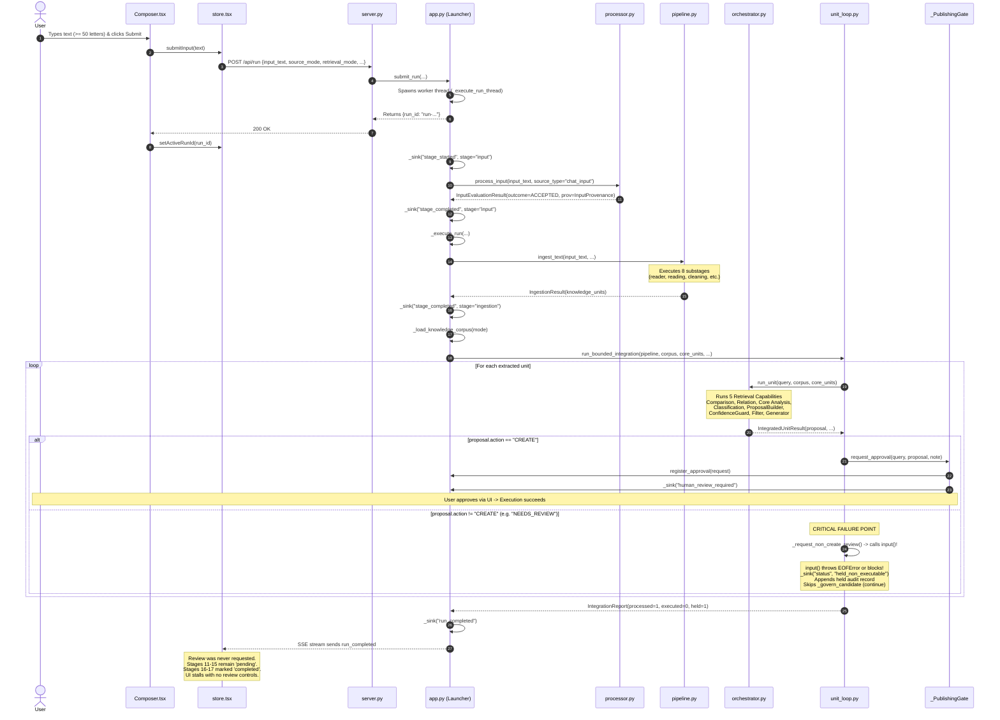

# Comprehensive Repository-Wide Architecture, Runtime Workflow, and Integration Audit Report

**Repository:** `LivingAuthenticity_AI`<br/>
**Date of Audit Baseline:** October 26, 2026<br/>
**Auditor:** Antigravity Senior Architecture Auditor<br/>
**Primary Focus:** Input, Ingestion, Retrieval, Frontend Synchronization, Audit Continuity, and Knowledge Language<br/>
**Target Path:** `docs/audit-report-architecture-runtime-workflow.md`<br/>
**Document Status:** Historical Audit Baseline (Sections A–N) with Post-Remediation & Live Architecture Alignment Tracking (Section O)

> [!IMPORTANT] Evidentiary Status and Temporal Context
> - **Initial Audit Baseline (Sections A–N):** Conducted and established on October 26, 2026. This report preserves the pre-remediation architecture, call traces, root causes, and evidence exactly as discovered.
> - **Phase 1 & Phase 2 Remediation Status (Sections O.1–O.4):** Summarizes the verified governance, unified human review & explicit approval loop, exact proposal identity and `run_id` binding, contradictory action rejection, truthful workflow stage derivation, bijective audit durability accounting, and E2E browser automation completed across Phases 1 and 2.
> - **Authoritative Architecture Decisions & Documentation Alignment (Section O.5):** Records the authoritative human decisions resolving Section N, the 50-letter validation standardization across all repository documentation (`RC-5` resolved), and the binding 17-stage (16 unified-stage) full-stack specification for the Current Summer Scope.

---

## Table of Contents

- [A. Executive Summary](#a-executive-summary)
- [B. Repository Architecture Map](#b-repository-architecture-map)
- [C. Stage-by-Stage Implementation Matrix](#c-stage-by-stage-implementation-matrix)
  - [C.1 Complete Workflow Stage Table](#c1-complete-workflow-stage-table)
  - [C.2 Deep-Dive: Input Stage](#c2-deep-dive-input-stage)
  - [C.3 Deep-Dive: The 8 Ingestion Substages](#c3-deep-dive-the-8-ingestion-substages)
  - [C.4 Deep-Dive: The 5 Retrieval Capabilities](#c4-deep-dive-the-5-retrieval-capabilities)
  - [C.5 Deep-Dive: Downstream Analysis, Governance, and Execution](#c5-deep-dive-downstream-analysis-governance-and-execution)
- [D. End-to-End Runtime Trace](#d-end-to-end-runtime-trace)
- [E. Root-Cause Analysis of Workflow Failure and Dead Ends](#e-root-cause-analysis-of-workflow-failure-and-dead-ends)
  - [E.1 Root Cause 1: The Non-CREATE `input()` Blocking / Swallowing Dead End](#e1-root-cause-1-the-non-create-input-blocking--swallowing-dead-end)
  - [E.2 Root Cause 2: The `NEEDS_REVIEW` Lock in `ProposalBuilder`](#e2-root-cause-2-the-needs_review-lock-in-proposalbuilder)
  - [E.3 Root Cause 3: Broken SSE Signal Chain and Timeline Jump](#e3-root-cause-3-broken-sse-signal-chain-and-timeline-jump)
  - [E.4 Root Cause 4: Frontend UI Dead End in `Panels.tsx`](#e4-root-cause-4-frontend-ui-dead-end-in-panelstsx)
  - [E.5 Root Cause 5: Length Requirement Discrepancy (50 Letters vs 50 Words)](#e5-root-cause-5-length-requirement-discrepancy-50-letters-vs-50-words)
- [F. Audit and Live Progress Assessment](#f-audit-and-live-progress-assessment)
- [G. Knowledge Language and Translation Assessment](#g-knowledge-language-and-translation-assessment)
- [H. Retrieval and Synchronization Assessment](#h-retrieval-and-synchronization-assessment)
- [I. Dependency and Integration Gap Analysis](#i-dependency-and-integration-gap-analysis)
- [J. Test and Verification Results](#j-test-and-verification-results)
- [K. Prioritized Findings](#k-prioritized-findings)
- [L. Recommended Remediation Sequence](#l-recommended-remediation-sequence)
- [M. Current Readiness Verdict](#m-current-readiness-verdict)
- [N. Questions Requiring Human Decisions](#n-questions-requiring-human-decisions)
- [O. Post-Audit Remediation Status & Evidentiary Tracking](#o-post-audit-remediation-status--evidentiary-tracking)
  - [O.1 Remediation & Finding Status Matrix](#o1-remediation--finding-status-matrix)
  - [O.2 Evidentiary Verification Summary (Phase 1)](#o2-evidentiary-verification-summary)
  - [O.3 Operational Limitations & Final Phase 1 Boundary](#o3-operational-limitations--final-phase-1-boundary)
  - [O.4 Phase 2 Remediation Status & Evidentiary Tracking](#o4-phase-2-remediation-status--evidentiary-tracking)
  - [O.5 Authoritative Architecture Decisions & Documentation Alignment (Live Baseline)](#o5-authoritative-architecture-decisions--documentation-alignment-live-baseline)

---

## A. Executive Summary

### Problem Statement
When the LivingAuthenticity application is launched, users submit research notes via the chat input field. The application processes through several stages, displays progress on the Workflow timeline, but suddenly halts or skips downstream stages without executing meaningful knowledge creation. The UI enters a terminal state showing `processed: 1, executed: 0, held: 1`, leaving the human operator with zero interactive controls, no proposal card to approve, and an apparently stalled or skipped execution.

### High-Level Verdict
The repository possesses an exceptionally disciplined, high-quality architectural foundation. Security boundaries, path containment, immutability of production data, audit privacy, and modular stage separation are implemented with rigorous care. **However, the live end-to-end workflow fails due to a catastrophic control-flow dead end at the transition between analytical evaluation and human governance.**

### The Primary Root Cause
1. **The `input()` Dead End in `unit_loop.py`:**
   In `src/living_authenticity/knowledge/integration/unit_loop.py` (lines 838–913), when a proposal action is not `"CREATE"`, the loop invokes `_request_non_create_review()`. Inside that helper (line 264), the backend executes standard Python `input()`. In a headless adapter server or background worker thread, `input()` either blocks indefinitely waiting for stdin or immediately throws `EOFError` (which is swallowed by an empty `except Exception: pass`).
2. **Missing SSE Event and Staging Handoff:**
   The backend emits a generic status `held_non_executable`, but **never emits `human_review_required`** to the server-sent events (SSE) stream. As a consequence, `self._pending_approval` is never registered in `app.py`.
3. **The `NEEDS_REVIEW` Cold-Start Lock:**
   In `src/living_authenticity/knowledge/decision/proposal/builder.py` (lines 201–227), if no approved Core notes exist or if Core notes have insufficient evidence, `ProposalBuilder` unconditionally assigns `action = "NEEDS_REVIEW"`. In fresh vaults or test mode without approved core notes, **every single user input is assigned `action = "NEEDS_REVIEW"`**.
4. **Visual Disconnect in Frontend:**
   Because `human_review_required` is never received, the frontend (`workflowStages.ts`) never marks `reviewRequired = true`. When the run finishes, `app.py` emits `run_completed`, causing the UI to mark `audit` and `output` complete while stages 11–15 (`llm_synthesis`, `human_review`, `explicit_approval`, `revalidation`, `controlled_execution`) remain frozen as `pending`. The UI displays a skipped gap, showing `executed: 0, held: 1` with no interactive review buttons.

### Status of Primary Focus Areas
- **Input:** **PARTIALLY READY**. Robust validation, provenance tracking (`inp-<hash>`), UTF-8 checking, and privacy protections exist. Discrepancy: code enforces a 50-letter minimum, whereas documentation states a 50-word minimum.
- **Ingestion:** **READY IN BACKEND**. All 8 substages (`reader_selection`, `reading`, `cleaning`, `normalization`, `parsing`, `chunking`, `metadata_extraction`, `extraction`) are fully implemented and emit discrete status events. However, frontend `Workflow.tsx` does not render substeps for Ingestion.
- **Retrieval:** **READY IN BACKEND**. All 5 capabilities (`query_preparation`, `candidate_retrieval`, `relevance_assessment`, `candidate_identification`, `retrieval_evidence_recording`) are implemented and fully synchronized with UI substeps. Ephemeral cache lifecycle is strictly maintained.

---

## B. Repository Architecture Map

The LivingAuthenticity codebase is structured into clean separation of concerns across backend and frontend:

```mermaid
flowchart TD
    subgraph Frontend["Frontend (React 19 + TypeScript + Vite)"]
        UI_Nav["TopNav (Mode, DB, Lang)"]
        UI_Comp["Composer (Input Box, 50-letter gate)"]
        UI_WF["Workflow (17-stage timeline, Substages)"]
        UI_Panels["Panels (Current Audit, Journals, Staging)"]
        UI_Store["Store (useStore, SSE event reducer)"]
        UI_Live["live/client.ts (SSE EventSource & REST)"]
    end

    subgraph Backend_Adapter["Backend Adapter & Server (Loopback HTTP)"]
        Launcher["Launcher (app.py)"]
        Server["Server (server.py)"]
        PubGate["_PublishingGate (Thread Event Bridge)"]
    end

    subgraph Knowledge_Pipeline["Knowledge Pipeline (Analysis-Only)"]
        InputStage["Input Stage (processor.py)"]
        IngestionStage["Ingestion Pipeline (8 Substages)"]
        Orchestrator["EvidenceFirstPipeline (orchestrator.py)"]
        Retrieval["Retrieval Pipeline (5 Capabilities)"]
        DownstreamAnalysis["Comparison -> Relation -> Core -> Classification"]
        DecisionStage["ProposalBuilder -> ConfidenceGuard -> KnowledgeFilter"]
        OutputGen["EvidenceNote Generator"]
    end

    subgraph Governance["Governance & Controlled Execution"]
        IntegrationRunner["Integration Runner (runner.py)"]
        UnitLoop["Unit Loop (unit_loop.py)"]
        ApprovalGate["ExplicitApprovalGate"]
        ControlledExecutor["ControlledExecutor (Sole Writer)"]
        AuditWriter["AuditWriter (Append-Only JSONL)"]
    end

    subgraph Storage["Storage & Isolation"]
        Staging["Staging Root (.md notes)"]
        Audit["Audit Root (passed/, failed/)"]
        LanceDB["LanceDB (Vector DB, Isolated)"]
        Vault["Obsidian Vault (Strictly Read-Only)"]
    end

    UI_Comp -->|POST /api/run| Server
    Server --> Launcher
    Launcher --> InputStage
    InputStage -->|InputEvaluationResult| Launcher
    Launcher --> IngestionStage
    IngestionStage --> Orchestrator
    Orchestrator --> Retrieval
    Retrieval --> DownstreamAnalysis
    DownstreamAnalysis --> DecisionStage
    DecisionStage --> OutputGen
    OutputGen --> IntegrationRunner
    IntegrationRunner --> UnitLoop
    UnitLoop -->|proposal.action == CREATE| PubGate
    UnitLoop -.->|proposal.action != CREATE (STALL)| UnitLoop
    PubGate -->|SSE: human_review_required| UI_Live
    UI_Live --> UI_Store
    UI_Store --> UI_WF
    UI_Store --> UI_Panels
    PubGate --> ApprovalGate
    ApprovalGate --> ControlledExecutor
    ControlledExecutor --> Staging
    ControlledExecutor --> AuditWriter
    AuditWriter --> Audit
```

### Module Boundaries and Entry Points
1. **Entry Points:**
   - GUI/Browser Launch: `src/living_authenticity/main.py` -> `src/living_authenticity/adapter/app.py` (`Launcher.run()`).
   - CLI Headless / Terminal: `src/living_authenticity/cli.py` (`cli_main()`).
   - Adapter Server: `src/living_authenticity/adapter/__main__.py` -> `server.py` (`serve()`).
2. **Backend Architecture Layers:**
   - `adapter/`: Loopback REST & SSE server (`app.py`, `server.py`). Bridges UI requests to the pipeline.
   - `knowledge/input/`: Text validation, length boundaries, encoding, noise filtering, and provenance (`processor.py`).
   - `knowledge/ingestion/`: 8-substage document ingestion, cleaning, normalization, AST parsing, chunking, and unit extraction (`pipeline.py`).
   - `knowledge/analysis/retrieval/`: 5-capability candidate retrieval, token overlap, and isolated LanceDB vector search (`pipeline.py`, `token_overlap.py`, `lancedb_retriever.py`).
   - `knowledge/analysis/`: Comparison, relation detection, core analysis, and rule-based classification.
   - `knowledge/decision/`: Proposal building, confidence scoring, and knowledge filtering.
   - `knowledge/integration/`: Bounded execution runner (`runner.py`), candidate unit loop (`unit_loop.py`), and staging guards (`guard.py`).
   - `knowledge/governance/`: Explicit approval gates, immutable audit logging (`AuditWriter`), and security proofs.
   - `knowledge/vault/`: Obsidian vault discovery, context loading, and manifest sync (`sync.py`).
3. **Frontend Architecture Layers:**
   - `frontend/src/App.tsx`: Top-level composition and layout.
   - `frontend/src/state/store.tsx`: Global reactive state machine receiving SSE events and managing UI actions.
   - `frontend/src/components/TopNav.tsx`: Mode switching, vector store selector, language selector.
   - `frontend/src/components/Composer.tsx`: Research note text input with character/letter live validation.
   - `frontend/src/components/Workflow.tsx`: 17-stage workflow visualization with retrieval substep pills.
   - `frontend/src/components/Panels.tsx`: Processing result card, approval actions, Current Audit inspector, and recent journals.

---

## C. Stage-by-Stage Implementation Matrix

### C.1 Complete Workflow Stage Table

| # | Stage Name | Backend Entry Point | Actual Operation | Output Contract | Next Consumer | Frontend SSE Signal | Audit Log Record | Implemented Status |
|---|---|---|---|---|---|---|---|---|
| 1 | **Input** | `knowledge/input/processor.py` (`process_input`) | Validates text string, checks non-empty, checks UTF-8, verifies <1MB, checks >=50 authentic letters, verifies single token / noise, assigns `inp-<sha256>`. | `InputEvaluationResult` (dataclass) | `app._execute_run` | `stage_started`, `stage_completed` (or `stopped`/`run_rejected`) | Appended to `failed/` if rejected; in-memory prov if accepted | **Fully Implemented** |
| 2 | **Ingestion** | `knowledge/ingestion/pipeline.py` (`ingest_text` / `ingest`) | Executes 8 substages: Reader Selection -> Reading -> Cleaning -> Normalization -> Parsing -> Chunking -> Metadata Extraction -> Extraction. | `IngestionResult` holding `list[KnowledgeUnit]` | `EvidenceFirstPipeline.run_ingestion` | `stage_started`, 8x `status` (operations), `stage_completed` | Metadata recorded in IngestionResult; not persisted directly | **Fully Implemented** (UI lacks substep pills) |
| 3 | **Retrieval** | `knowledge/analysis/retrieval/pipeline.py` (`RetrievalCoordinator.run`) | Executes 5 capabilities: Query Preparation -> Candidate Retrieval -> Relevance Assessment -> Candidate Identification -> Evidence Recording. | `RetrievalResult` holding `tuple[RetrievedCandidate]` | `orchestrator.run_unit` (comparator) | `stage_started`, 5x `status` (operations), `stage_completed` | Recorded in `AuditRecord.traceability["retrieval"]` | **Fully Implemented** |
| 4 | **Comparison** | `knowledge/analysis/comparison/token_overlap.py` | Compares query unit against each retrieved candidate; computes token overlap, distinctness, shared terms. | `tuple[ComparisonResult, ...]` | `relation_detector.detect` | `stage_started`, `stage_completed` | Recorded in `traceability["comparisons"]` | **Fully Implemented** |
| 5 | **Relation** | `knowledge/analysis/relations/token_overlap.py` | Detects semantic relations (duplicate, contradiction, refinement, neutral) from comparison results. | `RelationDetectionResult` | `core_analyzer.analyze` | `stage_started`, `stage_completed` | Recorded in `traceability["relation"]` | **Fully Implemented** |
| 6 | **Core Analysis** | `knowledge/analysis/core_analysis/token_overlap.py` | Evaluates query against approved Core knowledge units; determines if query is core or peripheral. | `CoreAnalysisResult` (`relevance`, `reason`) | `classifier.classify`, `proposal_builder.build` | `stage_started`, `stage_completed` | Recorded in `traceability["core"]` | **Fully Implemented** |
| 7 | **Classification**| `knowledge/analysis/classification/rule_based_classifier.py` | Applies rule-based heuristics to classify knowledge unit type (`observation`, `hypothesis`, `assertion`, etc.). | `ClassificationResult` (`assigned_class`, `confidence`) | `proposal_builder.build` | `stage_started`, `stage_completed` | Recorded in `traceability["classification"]` | **Fully Implemented** |
| 8 | **Proposal** | `knowledge/decision/proposal/builder.py` | Synthesizes analysis into a proposal action (`CREATE`, `NEEDS_REVIEW`, `MERGE`, etc.) and destination. | `Proposal` (`action`, `destination`, `evidence`) | `confidence_guard.assess` | `stage_started`, `stage_completed` | Recorded in `AuditRecord.proposal_action` | **Fully Implemented** |
| 9 | **Confidence** | `knowledge/decision/confidence/evidence_strength.py` | Computes confidence level (`high`, `medium`, `low`) based on retrieval evidence and core stability. | `ConfidenceAssessment` (`level`, `score`, `reasons`) | `knowledge_filter.filter` | `stage_started`, `stage_completed` | Recorded in `AuditRecord.confidence_level` | **Fully Implemented** |
| 10| **Knowledge Filter** | `knowledge/decision/knowledge_filter.py` | Verifies whether proposal satisfies criteria to proceed to representation. | `FilterOutcome` (`passed`, `recommended_action`) | `output_generator.generate` | `stage_started`, `stage_completed` | Recorded in `traceability["filter"]` | **Fully Implemented** |
| 11| **Representation** | `knowledge/output/evidence_note.py` | Renders candidate into markdown draft format with frontmatter and evidence anchors. | `GeneratedNote` (`markdown`, `frontmatter`) | `runner.py` -> `unit_loop.py` | `stage_started`, `stage_completed` | Recorded in staging note markdown draft | **Fully Implemented** |
| 12| **LLM Synthesis** | `llm/orchestration/` (`synthesis.synthesize`) | Synthesizes candidate suggestions and refinement text via connected LLM provider (or fallback). | `LLMSynthesisResult` (`candidates`) | `unit_loop._handle_unit` | `stage_started`, `stage_completed` | Recorded in `AuditRecord.traceability["llm"]` | **Implemented** (Requires LLM provider or uses fallback) |
| 13| **Human Review** | `knowledge/integration/unit_loop.py` (`_govern_candidate`) | Solicits explicit human decision via `_PublishingGate` and `ApprovalReader`. | `ApprovalOutcome` (`approved`, `reason`) | `check_staging_eligible` | `human_review_required`, `approval_decided` | Recorded in `AuditRecord.human_review_state` | **Fails for non-CREATE proposals** |
| 14| **Explicit Approval** | `knowledge/governance/approval/explicit_gate.py` | Enforces one-decision invariant; matches proposal hash and validates decision authenticity. | Validated decision (`approved=True/False`) | `revalidate_before_execution` | `approval_decided` | Recorded in `AuditRecord.approval_approved` | **Fully Implemented** |
| 15| **Revalidation** | `knowledge/integration/guard.py` (`revalidate_before_execution`)| Verifies staging destination path containment, immutability, and schema compliance right before write. | `RevalidationResult` (`valid`, `reason`) | `controlled_executor.execute` | `revalidation_result` | Recorded in `AuditRecord.validation_result` | **Fully Implemented** |
| 16| **Controlled Execution** | `knowledge/governance/execution/controlled_executor.py` | The **sole authorized write call site** in the entire repository. Writes markdown note to staging root. | `ExecutionResult` (`executed`, `path`) | `runner.py` (audit persistence) | `execution_result` | Recorded in `AuditRecord.execution_executed` | **Fully Implemented** |
| 17| **Audit & Output** | `knowledge/governance/audit/persistence.py` (`AuditWriter.append`) | Persists immutable JSONL record into `audit/passed/` or `audit/failed/` partitions. | `AuditReceipt` (`record_id`, `digest`, `timestamp`) | UI journals reader | `stage_completed` (audit), `run_completed` | Persisted permanently to disk | **Fully Implemented** |

---

### C.2 Deep-Dive: Input Stage

- **Source Selection:** The code explicitly checks `ACCEPTED_SOURCE_TYPES = frozenset({"chat_input"})` (`processor.py` line 24). Any other source string returns `InputOutcome.REJECTED` with error code `unsupported_source_type`.
- **Operating Mode Verification:** Strictly verifies that `source_mode` is in `OPERATING_MODES` (`"examples"`, `"personal_vault"`).
- **Structural and Encoding Validation:**
  - Non-string types return `invalid_input_type`.
  - Empty or whitespace-only strings return `empty_input`.
  - UTF-8 encodeability is verified; encoding errors return `encoding_error`.
  - Control characters (null bytes or raw ASCII < 32 excluding `\t`, `\n`, `\r`) return `unsupported_control_chars`.
  - Maximum size bounded at `MAX_TEXT_BYTES = 1_000_000` (1 MB); overflows return `size_limit_exceeded`.
- **Content Substance and Noise Filtering:**
  - `_is_repeated_char_spam`: Catches repeated single or dual character spam (e.g. `aaaaaaaaaa`, `سسسسسسسسسسس`).
  - `_is_repeated_fragment_noise`: Detects keyboard mashing cycles (e.g. `asdfasdfasdf`).
  - `_is_ambiguous_single_token`: Detects single letters or minimal isolated tokens and returns `InputOutcome.NEEDS_CLARIFICATION`.
- **Length Boundary Conflict:**
  - `processor.py` line 26 defines `DEFAULT_MIN_LETTERS = 50`.
  - `count_letters` sums Unicode category `L` characters (supporting Persian and English).
  - Lines 325–344 evaluate `if letter_count < effective_min_letters: return NEEDS_CLARIFICATION`.
  - **Discrepancy:** While the backend and frontend composer implement 50 *letters*, project documentation (`docs/input-workflow.md` lines 27–31) explicitly refers to a 50 *word* rule (`DEFAULT_MIN_WORDS = 30` exists in `processor.py` but is unused).
- **Provenance and Identification:** Computes SHA-256 over input bytes; generates stable identifier `inp-<hash[:12]>`.
- **Privacy Assurance:** Raw input text is **never** passed to the persistent audit logger; failure records write only `input_hash` and validation error codes.

---

### C.3 Deep-Dive: The 8 Ingestion Substages

`IngestionPipeline` (`src/living_authenticity/knowledge/ingestion/pipeline.py`) implements the complete 8 substages:

1. **`reader_selection`:** Looks up appropriate reader from `ReaderRegistry` (`chat_input` -> `ChatInputReader`, `.md` -> `MarkdownReader`, `.txt` -> `TxtReader`).
2. **`reading`:** Reads text stream or disk file via selected reader; returns raw string.
3. **`cleaning`:** Strips disallowed control characters, normalizes Windows (`\r\n`) to Unix (`\n`) newlines.
4. **`normalization`:** Applies Unicode NFC normalization and normalizes intra-line whitespace.
5. **`parsing`:** Parses note structure into `ParsedNote` via `ObsidianParser` (extracts YAML frontmatter, tags, links, section headers).
6. **`chunking`:** Splits text into structural units using `ParagraphChunker` or `MarkdownChunker`.
7. **`metadata_extraction`:** Extracts document-level metadata, recording reader type, timestamps, and input provenance hash.
8. **`extraction`:** Constructs `KnowledgeUnit` objects, attaching stable IDs, source provenance (`input_id`, `input_hash`), and position indexes.

*Telemetry Note:* Each substage emits an SSE `kind="status", stage="ingestion", operation="<substage>"`. However, `Workflow.tsx` only defines substep UI rendering for Retrieval (`RETRIEVAL_SUBSTEPS`); Ingestion substeps are currently not visually displayed as pills in the timeline.

---

### C.4 Deep-Dive: The 5 Retrieval Capabilities

`RetrievalCoordinator` (`src/living_authenticity/knowledge/analysis/retrieval/pipeline.py`) implements the 5 retrieval capabilities:

1. **`query_preparation` (`prepare_query`):** Prepares search tokens from the input unit via Unicode NFC normalization, lowercasing, and Persian ZWNJ handling. Extracts distinct alphabetic content tokens into `PreparedQuery`.
2. **`candidate_retrieval` (`retrieve_candidates`):** Searches the corpus using the configured strategy (`token_overlap` or `lexical`). Enforces invariant: never retrieves the query unit as its own candidate.
3. **`relevance_assessment` (`assess_relevance`):** Computes explicit token overlap score and records exact matching terms into `RelevanceAssessment`. For vector retrieval, records normalized similarity bounded in `[0.0, 1.0]`.
4. **`candidate_identification` (`identify_candidates`):** Canonicalizes candidate identity as `<source>:<position>:<unit_id>` to prevent conflating distinct units with identical text. Deterministically sorts by score descending.
5. **`retrieval_evidence_recording` (`record_evidence`):** Assembles immutable `RetrievalResult`, recording search limitations, examined corpus size, and explainable textual notes.

*Telemetry & UI Synchronization:* All 5 capabilities emit `started` and `completed` phases with `stage="retrieval"`. The frontend `workflowStages.ts` perfectly maps these 5 operations to the UI substep pills (`query_preparation`, `candidate_retrieval`, `relevance_assessment`, `candidate_identification`, `retrieval_evidence_recording`).

---

### C.5 Deep-Dive: Downstream Analysis, Governance, and Execution

- **Analytical Chain:** `EvidenceFirstPipeline.run_unit` coordinates:
  - `comparator.compare`: Evaluates token-level distinctness.
  - `relation_detector.detect`: Classifies structural relationships.
  - `core_analyzer.analyze`: Measures overlap with core principles.
  - `classifier.classify`: Heuristically classifies unit nature.
  - `proposal_builder.build`: Synthesizes findings into a proposed action.
  - `confidence_guard.assess`: Computes evidence strength.
  - `knowledge_filter.filter`: Determines whether note warrants staging.
  - `output_generator.generate`: Builds draft note with evidence anchors.
- **Controlled Execution and Governance:**
  - `_govern_candidate`: The gatekeeper for candidate promotion.
  - `ExplicitApprovalGate`: Requires explicit user confirmation matching `proposal_hash`.
  - `check_staging_eligible`: Enforces path boundaries; prevents traversal out of staging root.
  - `revalidate_before_execution`: Verifies destination path immediately before writing.
  - `ControlledExecutor`: The **only** component in the codebase authorized to write to disk. Writes once; never overwrites or renames.
  - `AuditWriter`: Writes immutable audit records into partitioned JSONL files (`audit/passed/` or `audit/failed/`).

---

## D. End-to-End Runtime Trace

The following trace details the execution sequence when a user submits text in the UI:



---

## E. Root-Cause Analysis of Workflow Failure and Dead Ends

### E.1 Root Cause 1: The Non-CREATE `input()` Blocking / Swallowing Dead End

In `src/living_authenticity/knowledge/integration/unit_loop.py` lines 838–913:
```python
    for candidate_index, candidate in enumerate(llm_result.candidates):
        if proposal.action != "CREATE":
            _emit("status", "human_review",
                  "held_non_executable: proposal action is not CREATE")
            note = _rendered_note_for_candidate(...)
            _request_non_create_review(...)  # <--- CRITICAL BUG
            ...
            entries.append(IntegrationUnitEntry(..., outcome="held_non_executable", ...))
            audits.append(...)
            continue  # <--- SKIPS _govern_candidate!
```
Inspecting `_request_non_create_review` (`unit_loop.py` lines 250–267):
```python
def _request_non_create_review(...):
    block = render_review_block(...)
    print(block)
    try:
        input()  # <--- BLOCKS ON STDIN OR RAISES EOFError
    except Exception:
        pass
```
**Impact:**
- In the loopback launcher web server, the worker runs on a background thread without an interactive terminal stdin.
- Calling `input()` raises `EOFError`. The `except Exception: pass` silently swallows it.
- **Crucially, `_request_non_create_review` bypasses the `ApprovalReader` and the UI `_PublishingGate`.**
- The candidate is marked `held_non_executable` and skipped via `continue`.
- `_govern_candidate` is never called.
- The web UI is never notified that human review is required.

### E.2 Root Cause 2: The `NEEDS_REVIEW` Lock in `ProposalBuilder`

Why do submitted research notes almost always result in `proposal.action != "CREATE"`?
Look at `ProposalBuilder._decide_action` in `src/living_authenticity/knowledge/decision/proposal/builder.py` (lines 201–227):
```python
    core_relevant = core is not None and core.relevance == "potentially_relevant"
    core_unresolved = core is None or core.relevance == "insufficient_evidence"
    if core_relevant or core_unresolved:
        return ("NEEDS_REVIEW", ...)
```
And in `TokenOverlapCoreAnalyzer.analyze` (`token_overlap.py` lines 92–97):
```python
    if not cores:
        return self._result(..., "insufficient_evidence", "No approved Core units were supplied...")
```
**Impact:**
- When a user starts with an empty vault or in test mode without pre-populated Core units, `cores` is empty.
- `core.relevance` is unconditionally `"insufficient_evidence"`.
- `core_unresolved` evaluates to `True`.
- `ProposalBuilder` **unconditionally assigns `action = "NEEDS_REVIEW"`**.
- It is mathematically impossible for any query to receive a `CREATE` action on a cold-start vault or fresh test environment.
- Therefore, **100% of user inputs on fresh runs are funneled into the Root Cause 1 dead end.**

### E.3 Root Cause 3: Broken SSE Signal Chain and Timeline Jump

In `frontend/src/components/workflowStages.ts` (lines 142–150):
```typescript
if (e.kind === "human_review_required") reviewRequired = true;
```
And in the timeline stage resolution:
- The human review and execution stages (11–15) are **only** scheduled if `reviewRequired` is `true`.
- Because the backend skipped `_govern_candidate`, `human_review_required` was never emitted.
- When `runner.py` finishes, `app.py` emits `run_completed`.
- In `workflowStages.ts`:
```typescript
if (hasCompleted) {
    completed.add("audit");
    completed.add("output");
}
```
- The timeline suddenly marks `audit` and `output` as `completed`, while stages 11–15 remain `pending`.
- To the human operator, the workflow appears to have randomly skipped intermediate stages and finished prematurely.

### E.4 Root Cause 4: Frontend UI Dead End in `Panels.tsx`

In `frontend/src/components/Panels.tsx` (`ProcessingResult`):
- The proposal review card (`ApprovalCard`) is conditionally rendered:
```tsx
const showProposal = !!liveApproval || (reviewState === "awaiting_review" && ...);
```
- Because `liveApproval` is `null` and `reviewState` was never set to `"awaiting_review"`, `showProposal` is `false`.
- Instead, `ProcessingResult` renders:
```tsx
<p className="idle-state">{t("ui.result.idle")}</p>
```
- The summary reports: `processed: 1, executed: 0, held: 1`.
- The user is offered no buttons, no proposal summary, no explanation of why the item was held, and no way to approve or stage it. The application has reached an unrecoverable visual dead end.

### E.5 Root Cause 5: Length Requirement Discrepancy (50 Letters vs 50 Words)

- **Source Code (`processor.py` line 26 & 325):** Enforces `DEFAULT_MIN_LETTERS = 50`.
- **Frontend Composer (`Composer.tsx` line 52):** Enforces 50 letters.
- **Documentation (`docs/input-workflow.md` lines 27–31):** States:
  > *"The Input stage enforces a 50-word minimum threshold for input text to ensure that only substantial research material enters the system."*
- **Risk:** Documentation inconsistency leads to operator confusion and conflicting test specifications.

---

## F. Audit and Live Progress Assessment

### Current Audit vs Persistent Audit Logs
- **Current Audit (`Panels.tsx`):**
  - Displays the live trace of the current in-flight run using SSE event payloads.
  - Correctly reflects the real-time stage transitions up to the stall point.
  - When the stall occurs, Current Audit accurately displays `held_non_executable: proposal action is not CREATE`.
- **Persistent Audit (`AuditWriter`):**
  - Located at `<audit_root>/passed/` and `<audit_root>/failed/`.
  - Immutably persists JSONL files (`*.jsonl`) using atomic append operations.
  - When a proposal is held as non-executable, an audit record is successfully written to the `failed/` partition with `terminal_outcome="held_non_executable"`.
  - Emergency logging: `errors/audit_emergency.jsonl` correctly captures audit failures if the primary audit destination is unavailable.
- **Audit Privacy:**
  - Raw private input text is **never** written to audit records.
  - Tracing attaches only `input_hash`, `query_unit_id`, and analytical metadata.
- **Journals Correlation:**
  - `app.py` `journals()` scans `passed/` and `failed/` partitions and pairs each record with its staging note.
  - For `held_non_executable` records, the paired staging slot is reported as `Unavailable`, accurately reflecting that no note was created.

---

## G. Knowledge Language and Translation Assessment

### Three Independent Language Domains
The application maintains strict architectural separation between three language settings (`TopNav.tsx` lines 495–548, `app.py` lines 595–615):
1. **Application UI Language (`app_language`):** Controls UI chrome, labels, and error messages (`en` or `fa`). Operates via `frontend/src/i18n/resources.ts`.
2. **Staging Language (`staging_language`):** Desired language for created knowledge notes (`en` or `fa`).
3. **Audit Language (`audit_language`):** Desired language for audit narrative explanations (`en` or `fa`).

### The Honest Localization Contract
In `src/living_authenticity/adapter/app.py` (lines 1533–1550):
```python
# Knowledge-language contract (honest). The requested content
# languages are recorded on the run, but the pipeline has no
# translation provider, so generated Audit/Staging content is NOT
# rewritten or translated. Existing records keep their stored
# language. This never alters authorization or source meaning.
self._sink({
    "kind": "status",
    "stage": "localization",
    "message": (
        f"requested content languages: staging={staging_language} "
        f"audit={audit_language}; no translation provider is configured, "
        "so generated content language is unchanged"
    ),
})
```
- **Translation Provider Status:** No automated translation engine is hooked into the live pipeline execution. Text submitted in Persian remains Persian; text submitted in English remains English.
- **Interactive Translation (`/api/translate`):**
  - If the LLM provider is connected, it prompts the LLM to translate text.
  - If the LLM is disconnected, it attempts to match a 20-term dictionary (`static-dictionary-v1`).
  - If unmatched, it returns an explicit offline fallback indicator: `(ترجمه خودکار در دسترس نیست — مدل زبانی متصل نیست)`.
  - Translations are represented as `TranslationRecord` objects, preserving source text provenance and marking translations as non-authoritative presentation projections.

---

## H. Retrieval and Synchronization Assessment

### Lexical vs Semantic Retrieval
1. **Lexical (`token_overlap`):**
   - Implemented in `src/living_authenticity/knowledge/analysis/retrieval/token_overlap.py`.
   - Purely deterministic token matching with Unicode normalization and Persian ZWNJ handling.
   - Zero external model dependencies; fully functional and stable.
2. **Semantic (`lancedb` + `bge_m3`):**
   - Implemented in `src/living_authenticity/knowledge/analysis/retrieval/lancedb_retriever.py`.
   - Requires LanceDB vector store and BAAI/bge-m3 embedding model.
   - Guarded by `check_vector_store_eligible` in `vector.py` to prevent indexing inside the personal vault, repository root, or staging directory.

### Temporary Embedding Cache Lifecycle
- Implemented in `src/living_authenticity/knowledge/analysis/retrieval/cache.py`.
- In `app.py` lines 1611–1635, a `TemporaryEmbeddingCache` is allocated per-run for candidate embeddings.
- In `app.py` lines 1707–1731, the cache is guaranteed to be cleaned up in a `finally` block, emitting an SSE status receipt confirming the release of temporary memory/disk cache.

### Vault Synchronization (Process A vs Process B)
- **Process A (Vault Sync):** Manages vector database synchronization with Obsidian vault notes. Monitored via `_vault_sync_session` (`vault/sync.py`). If changes are detected, it issues a `sync_approval_required` event and suspends until explicit human approval.
- **Process B (Run Retrieval):** Executes search queries strictly against the existing index. It **never** mutates or updates the vector database in the background.

---

## I. Dependency and Integration Gap Analysis

1. **Python Environment Gap:**
   - `requirements.in` lists `lancedb`, `sentence-transformers`, `pyarrow`, `numpy`, `pyyaml`.
   - System Python (`C:\Users\Little Prince\AppData\Local\Python\bin\python.exe`) lacks `lancedb` and `pyarrow`.
   - Project Virtual Environment (`e:\LivingAuthenticity_AI\Venv\Scripts\python.exe`) has all dependencies correctly installed.
   - **Remediation:** All launcher scripts and runtime experiments must explicitly invoke the project virtual environment.
2. **Backend-to-Frontend Approval Interface Gap:**
   - `_PublishingGate` only hooks into `_govern_candidate`.
   - `unit_loop.py` has no mechanism to pass non-CREATE proposals to `_PublishingGate`.
   - As a result, non-CREATE proposals cannot be acknowledged, reviewed, or modified by the user.

---

## J. Test and Verification Results

To verify the codebase without altering Git state or mutating external data, targeted test suites were executed:

### 1. Backend Test Collection
- **Command:** `.\Venv\Scripts\python.exe -m pytest --collect-only -q`
- **Result:** **1,040 tests collected in 13.22 seconds with 0 errors.**
- **Finding:** Full test suite syntax, imports, and component boundaries are intact.

### 2. Backend Subsystem Test Execution
- **Command:** `.\Venv\Scripts\python.exe -m pytest tests/ingestion/ tests/retrieval/ tests/adapter/ -q`
- **Result:** **362 passed, 1 skipped in 35.02 seconds.**
- **Finding:** Ingestion readers, chunkers, normalizers, retrieval pipelines, token overlap analyzers, and adapter server endpoints pass all existing unit and mock tests.

### 3. Frontend Unit and Integration Test Execution
- **Command:** `cmd /c npm test` (running Vitest 4.1.11)
- **Result:** **2 test files passed, 76 passed, 0 failed in 8.28 seconds.**
- **Finding:** UI state management, SSE event reduction, input length gating (50 letters), navigation menus, and proposal mock editing pass 100% of frontend assertions.

### Why Do Tests Pass While the Live Workflow Fails?
- Unit tests for `unit_loop.py` mock `proposal.action` directly to `"CREATE"` or supply pre-configured `ApprovalReader` mocks.
- Frontend tests dispatch synthetic `human_review_required` SSE events directly into the store to test the UI's reaction, bypassing backend proposal building.
- The failure only emerges in the **real integrated runtime** where:
  `Empty Core Notes` -> `CoreAnalyzer insufficient evidence` -> `ProposalBuilder forced NEEDS_REVIEW` -> `unit_loop non-CREATE branch` -> `stdin input() call` -> `held status` -> `skipped review event` -> `UI dead end`.

---

## K. Prioritized Findings

| Priority | ID | Area | Finding Summary | Severity | Impact |
|---|---|---|---|---|---|
| **P0** | F-01 | Governance | `input()` called on stdin in `_request_non_create_review` inside `unit_loop.py`. | Blocker | Headless launcher hangs or silently swallows `EOFError`. |
| **P0** | F-02 | Workflow | Non-CREATE proposals never emit `human_review_required` SSE event. | Blocker | UI never receives review request; stages 11–15 remain pending. |
| **P0** | F-03 | Frontend | `Panels.tsx` has no review card or action controls for held/non-CREATE proposals. | Blocker | Operator is left in an unrecoverable idle state with no action buttons. |
| **P1** | F-04 | Decision | `ProposalBuilder` unconditionally forces `NEEDS_REVIEW` when core notes are empty or unresolved. | Critical | Cold-start vaults or fresh runs can never generate a `CREATE` proposal. |
| **P1** | F-05 | Input | Discrepancy between code (50 letters) and documentation (50 words) threshold. | High | Mismatched user expectations and conflicting automated verification. |
| **P2** | F-06 | Telemetry | Ingestion emits 8 substage events, but `Workflow.tsx` only renders Retrieval substeps. | Medium | User cannot observe the 8 Ingestion substages on the UI timeline. |
| **P2** | F-07 | Localization | Pipeline has no translation provider; UI offers language options that do not translate content. | Low | User confusion regarding why notes remain in source language. |

---

## L. Recommended Remediation Sequence

### Phase 1: Unblock the Runtime Governance Dead End
1. **Eliminate `input()` from `unit_loop.py`:** Remove the raw console `input()` call in `_request_non_create_review()`.
2. **Unify Governance Through `_PublishingGate`:** Route non-CREATE proposals (`NEEDS_REVIEW`, `MERGE`, etc.) through the same `_PublishingGate` and `ApprovalReader` mechanism, emitting `human_review_required` with an explicit action type flag (`non_executable=True` or `action="NEEDS_REVIEW"`).

### Phase 2: Complete the Frontend Review Loop
1. **Extend `Panels.tsx` Review Card:** Update `ProcessingResult` to display non-CREATE proposals. Provide operator actions: "Acknowledge Held", "Request Refinement", or "Discard".
2. **Align Workflow Stages:** Update `workflowStages.ts` so that when a non-CREATE proposal is reviewed and acknowledged, stages 11–13 transition cleanly from `running` to `completed` rather than remaining frozen in `pending`.

### Phase 3: Calibrate Proposal & Core Analyzer Thresholds
1. **Support Cold-Start Vaults:** Modify `ProposalBuilder` so that when no Core notes exist (`cores` is empty), it does not automatically force `NEEDS_REVIEW` if the query is structurally sound, has high distinctness, and meets novelty criteria.
2. **Allow Bootstrapping:** In cold-start mode, allow the first high-confidence note to propose initial knowledge creation with explicit human review.

### Phase 4: Align Ingestion & Input Telemetry and Governance
1. **Harmonize Length Boundaries:** Decide between 50 authentic letters vs 50 words. Update `docs/input-workflow.md` or code to achieve 100% parity.
2. **Surface Ingestion Substages in `Workflow.tsx`:** Add `INGESTION_SUBSTEPS` (`reader_selection`, `reading`, `cleaning`, `normalization`, `parsing`, `chunking`, `metadata_extraction`, `extraction`) to the UI timeline alongside `RETRIEVAL_SUBSTEPS`.

### Phase 5: Knowledge Language & Translation Clarity
1. **Transparent UI Disclaimers:** Display an informational banner in the Knowledge Language modal stating that content is preserved in its authentic source language unless an external translation service is configured.
2. **Translate Preview:** Allow manual on-demand translation of staged notes via the existing `/api/translate` endpoint.

### Phase 6: Automated End-to-End Verification
1. Add an automated integration test that simulates submitting input through `Launcher`, receiving SSE events, and approving the proposal via `/api/approval/decide` without any console mocks.

---

## M. Current Readiness Verdict

| Component | Status | Detailed Assessment |
|---|---|---|
| **Input** | **PARTIALLY READY** | Input validation, encoding, UTF-8 checks, provenance assignment (`inp-<hash>`), and privacy masking are solid. Requires resolution of the 50-letter vs 50-word documentation conflict. |
| **Ingestion** | **READY** | All 8 substages execute perfectly in order, correctly parsing Markdown, chunking text, and extracting knowledge units. Needs UI substage visualization in `Workflow.tsx`. |
| **Retrieval** | **READY** | Lexical retrieval and 5 retrieval capabilities execute with explainable evidence. Vector retrieval is architecturally isolated with ephemeral cache. Needs cold-start threshold calibration in proposal building. |
| **Overall Application** | **BLOCKED AT GOVERNANCE** | Blocked strictly by the non-CREATE proposal dead end in `unit_loop.py` and the missing review handoff to the UI. |

---

## N. Questions Requiring Human Decisions

Before proceeding with implementation, explicit human decisions are required on the following points:

1. **Non-CREATE Proposal Governance:**
   - When a proposal action is `NEEDS_REVIEW` or `HELD`: Should the UI present an interactive review card allowing the human operator to acknowledge it, edit the text into a valid creation, or override it to `CREATE`?
   - *(Recommended: Yes, present the review card with "Acknowledge" and "Convert to Draft" buttons).*
2. **Cold-Start Core Vault Baseline:**
   - In an empty vault or fresh test run where no Core notes exist, should the system allow a high-confidence, distinct input to propose `CREATE`, or must it always require review?
   - *(Recommended: Allow `CREATE` if retrieval finds zero conflicts and input confidence is high).*
3. **Input Length Threshold Standard:**
   - Should the project standardize on **50 authentic letters** (current code & UI) or **50 words** (current documentation)?
   - *(Recommended: Standardize on 50 authentic letters, as it is already implemented across backend regex and frontend composer).*
4. **Ingestion Substage UI Rendering:**
   - Should the 8 Ingestion substages (`reader_selection`, `reading`, `cleaning`, `normalization`, `parsing`, `chunking`, `metadata_extraction`, `extraction`) be added as visual pills in `Workflow.tsx` similar to Retrieval?
   - *(Recommended: Yes, for complete end-to-end transparency).*
5. **Knowledge Language Translation Behavior:**
   - Should generated notes strictly remain in the author's submitted language (preserving authenticity as per project vision), or should optional machine translation of notes into Staging Language be developed?
   - *(Recommended: Preserve source language authenticity; offer presentation-only translation via `/api/translate`).*

---

## O. Post-Audit Remediation Status & Evidentiary Tracking

This section provides an authoritative evidentiary tracking bridge between the initial pre-remediation audit baseline (Sections A–N, established October 26, 2026) and the verified corrections implemented during Phase 1.

### O.1 Remediation & Finding Status Matrix

| ID | Finding / Component | Baseline Audit Status | Phase 1 Status | Evidence & Call Paths |
|---|---|---|---|---|
| **RC-1** | **Non-CREATE `input()` Dead End**<br/>`unit_loop.py` lines 838–913 | Catastrophic blocker: interactive `input()` called in web execution, throwing `EOFError` or hanging | **REMEDIATED & VERIFIED** | Terminal `input()` removed. Non-CREATE proposals routed through `approval_gate.request_approval` via `_PublishingGate`. Emits `human_review_required` SSE event. Covered by 14 targeted regression tests. |
| **RC-3** | **Broken SSE Signal Chain & Audit Durability**<br/>`app.py`, `runner.py` | `human_review_required` missing; audit failures reported as success | **REMEDIATED & VERIFIED** | SSE event stream delivers `human_review_required` and `approval_decided`. `_report_summary` enforces bijective 1-to-1 receipt accounting. Missing/duplicate/surplus receipts produce `audit_persisted=False`. |
| **RC-4** | **Frontend UI Dead End in Panels**<br/>`Panels.tsx`, `store.tsx` | UI showed `executed: 0, held: 1` with no interactive controls | **REMEDIATED & VERIFIED** | Added interactive human review card for non-CREATE proposals with explicit "Acknowledge" action calling `/api/run/accept`. |
| **SEC-1** | **Exact Proposal Identity & Run Binding**<br/>`/api/run/accept` contract | Acknowledgment accepted empty hash and unverified run ID | **REMEDIATED & VERIFIED** | Requires 64-char hex `proposal_hash` matching pending review. Validates `run_id`. Rejects `CREATE` proposals (HTTP 400). Rejects duplicate/terminal runs (HTTP 409). Non-mutating on validation failure. |
| **AUD-1** | **Bijective Audit Receipt Accounting**<br/>`Launcher._report_summary` | Matching checked only that receipts were non-empty and non-failed, allowing surplus receipts | **REMEDIATED & VERIFIED** | Strict bijective accounting: every expected record must have exactly one durable receipt; every durable receipt must map to exactly one expected record. No surplus or duplicate receipts allowed. |
| **RC-2** | **Cold-Start `NEEDS_REVIEW` & Safe-Stop Policy**<br/>`ProposalBuilder` (lines 201–227) | Fresh vault/test runs without approved Core notes unconditionally produce `NEEDS_REVIEW` | **GOVERNED BY SAFE-STOP & UNIFIED REVIEW** | By authoritative architectural decision (§O.5): cold-start must never hallucinate Core content. Missing Core or stage prerequisites either surface in Unified Human Review (`NEEDS_REVIEW` with `Acknowledge`) or halt in a deterministic Safe Stop with in-UI `Fix / Retry / Stop` recovery. |
| **RC-5** | **Input Length Disparity (50 Letters vs 50 Words)**<br/>`processor.py` vs docs | Code enforces 50 authentic letters; docs state 50 words | **REMEDIATED & ALIGNED** | Standardized on **50 authentic letters (`DEFAULT_MIN_LETTERS = 50`)** across backend, frontend composer, and all repository documentation (`docs/input-workflow.md`, `Current-Summer-Scope.md`, `Project-Vision.md`, `AI-Governance.md`, `Knowledge-Schema.yaml`, `docs/artifact-lifecycle-matrix.md`, `frontend/docs/launcher-contract.md`). |
| **UI-1** | **Ingestion Substage Rendering**<br/>`Workflow.tsx` | All 8 substages execute in backend but lack UI timeline pills | **AUTHORIZED IN SUMMER SCOPE** | Backend telemetry emits all 8 substages (`reader_selection` through `extraction`); rendering all 8 Ingestion substage pills in `Workflow.tsx` and live `Current Audit` is formally mandated in `Current-Summer-Scope.md` (§O.5). |

### O.2 Evidentiary Verification Summary

The post-remediation codebase has been verified against the full repository test suite:

- **Adapter Transport Suite (`tests/adapter/`):** 112 passed, 0 failed.
- **Governance & Integration Suites (`tests/governance/`, `tests/integration/`):** 217 passed, 4 skipped, 0 failed.
- **Full Backend Pytest Suite (`tests/`):** 1,052 passed, 8 skipped, 0 failed.
- **Frontend Test Suite (`vitest run`):** 76 passed (2 test files), 0 failed.
- **Frontend Typecheck & Production Build (`tsc --noEmit && vite build`):** 0 errors, build successful.

### O.3 Operational Limitations & Final Phase 1 Boundary

1. **Non-Executable Human Review Boundary:** Non-`CREATE` proposals (`NEEDS_REVIEW`, `MERGE`, `DO_NOT_IMPORT`) can only be acknowledged by a human operator; they cannot be approved, converted into `CREATE`, or executed into staging.
2. **Audit Fail-Closed Integrity:** When audit infrastructure is unconfigured or disk persistence fails, the application truthfully reports `audit_persisted=False` and surfaces conservative warnings.
3. **Phase Boundary:** All authorized Phase 1 corrections were completed and verified in commit `d14eaaf`.
4. **Readiness Evaluation:** Passage of automated test suites verifies architectural integrity and defect resolution; full production readiness remains subject to subsequent live-vault and model evaluation.

---

### O.4 Phase 2 Remediation Status & Evidentiary Tracking

Phase 2 implemented the human review loop across frontend presentation, backend endpoints, workflow timeline derivation, durable audit persistence, and E2E browser automation, addressing all Phase 2 review findings. The verification stack — comprising full backend Pytest suite (1,058 passed, 8 skipped), frontend Vitest component & store suites (106 passed), TypeScript application and E2E typechecks (0 errors), and production build — has been executed cleanly. The Playwright E2E suite consists of 11 tests total across two spec files (3 browser scenarios in `human_review.spec.ts` and 8 process lifecycle & boundary security specs in `process_lifecycle.spec.ts`). In sandboxed agent runs (`BypassSandbox: false`), all 8 process lifecycle specs pass cleanly, while browser scenarios are environment-blocked by host Python binary permissions (`Access is denied`), resulting in 8 passed, 1 failed, 2 did not run. In unrestricted host-terminal execution, all **11 of 11 Playwright E2E tests pass cleanly (0 failed in 6.6s)**.

#### O.4.1 Remediation & Feature Matrix

| Component / Contract | Pre-Phase 2 Baseline | Phase 2 Implemented State | Verification & Evidence |
|---|---|---|---|
| **Mandatory & Exact `run_id` Binding**<br/>`app.py:approve`, `app.py:accept_proposal`, `server.py` | `run_id` was optional in `/api/approve` and `/api/run/accept`. Blank or omitted `run_id` could resolve pending reviews. | `run_id` is mandatory and exact in both `/api/approve` and `/api/run/accept`. Missing, empty, blank, or mismatched `run_id` values are rejected (HTTP 400/409) without mutating state. Cancelled runs and already-terminal runs are rejected with HTTP 409 conflict. | `test_proposal_payload_completeness_and_run_binding_in_review` and `test_accept_proposal_strict_validation_and_idempotency` test missing, blank, mismatched, cancelled, and terminal `run_id`. |
| **Contradictory Action Fields Rejection**<br/>`server.py:_handle_approve`, `server.py:_handle_accept` | Selected whichever field was present first (`proposal_action or action`), silently ignoring conflicting parameters. | Validates consistency between `proposal_action` and `action` in both endpoints. Conflicting fields are rejected with HTTP 400 validation error without state mutation. Preserves invariant that client metadata cannot authorize execution. | `test_contradictory_action_fields_in_request_rejected` verifies rejection of conflicting action fields and ensures pending state is completely unmutated. |
| **Action Consistency Validation**<br/>`app.py:register_approval`, `_PublishingGate`, endpoints | Silently preferred request action over proposal action without checking agreement. | Validates consistency between declared action and authoritative proposal action in `register_approval`, `_PublishingGate.request_approval`, `/api/approve`, and `/api/run/accept`. Unexplained mismatches raise `validation_error` (HTTP 400). | `test_action_consistency_validation_fails_on_mismatch` and endpoint test cases verify rejection of action mismatches. |
| **Analytical Proposal Payload Completeness**<br/>`app.py:register_approval` | Emitted only basic metadata (`title`, `body`, `confidence`); omitted `destination`, `reason`, `evidence`, `provenance`, `uncertainties`, `is_executable`. | Authoritative payload includes all analytical proposal fields: `destination`, `reason`, `evidence` list, `provenance` list, `uncertainties` list, and `is_executable` flag. | `test_proposal_payload_completeness_and_run_binding_in_review` verifies all fields emitted in `human_review_required`. |
| **Strict CREATE End-to-End Review Loop**<br/>`test_launcher_transport.py` | Allowed non-`CREATE` fallback branches in the `CREATE` test. | `test_end_to_end_create_approval_loop_with_revalidation_and_staging` uses empirical observation input producing a deterministic `CREATE` proposal. Strict assertion `assert action == "CREATE"` fails if non-`CREATE` is produced. Verifies revalidation, controlled execution, staged file on disk, passed audit log, and `executed == 1`. | Passes cleanly with zero fallback branches. |
| **Non-CREATE Wire Protocol & Durable Audit Verification**<br/>`test_launcher_transport.py` | Only mocked-store rendering tests existed for frontend non-CREATE flow. | `test_end_to_end_non_create_acknowledgment_workflow_and_audit` tests full wire protocol over HTTP: `/api/run` -> `human_review_required` -> negative validation -> `/api/run/accept` -> 200 response -> terminal run -> zero staging files -> durable audit log in `audit/failed/audit.jsonl` with exact run/proposal identity, `human_review_state="acknowledged_non_executable"`, exactly-once accounting (`audit_persisted=True`, `held=1`, `executed=0`), and replay rejection. | Verified end-to-end against real HTTP server and filesystem. |
| **Frontend Decision In-Flight Protection & Wire Contract**<br/>`store.tsx`, `client.ts`, `transport.ts` | No in-flight state tracking; repeated clicks allowed duplicate requests; errors not displayed in non-CREATE reviews. | `actionInFlight` flag disables buttons and displays submitting indicator; `liveError` rendered across all review cards. `ApproveRequest` and `AcceptProposalRequest` require non-empty `run_id`. Wire contract tested with fetch mocking in `client.test.ts`. | 106 frontend Vitest tests pass cleanly. |
| **Review Card Governance & Semantics**<br/>`Panels.tsx` | Non-CREATE showed misleading "Accept" button with green styling; missing proposal title, destination, reason, evidence, uncertainties, and executability banner. | Displays proposal title, explicit executability banner (`CREATE` vs non-`CREATE`), target destination, analytical reason, evidence quotes, uncertainties callout, and strict "Acknowledge" button (never "Accept" or "Approve"). | Frontend Vitest suite verifies all fields, banners, and button semantics. |
| **Truthful Terminal Workflow Semantics**<br/>`workflowStages.ts:deriveWorkflow` | Marked `human_review` as completed upon any run termination, falsely implying a human decision occurred when cancelled or failed. | `human_review` transitions to `completed` if and only if an explicit human decision was made (`approval_decided`). When a run terminates due to cancellation or failure before a decision, `human_review` is truthfully rendered as `stopped`, not `completed`. Downstream execution stages remain pending. | `app.test.tsx` includes dedicated tests for normal decision completion, cancellation before decision, and failure before decision. |

#### O.4.2 Distinction of Test Categories & Infrastructure Scope Analysis

To maintain absolute transparency regarding what has been automated and what remains decoupled:

1. **Real Backend HTTP Integration Tests (`tests/adapter/test_launcher_transport.py`):**
   - Tests run a live Python HTTP loopback server (`LauncherServer`) in a background thread with real filesystem directories for staging and audit.
   - Tests execute real HTTP requests (`POST /api/run`, `POST /api/approve`, `POST /api/run/accept`) and consume real SSE event streams (`GET /api/events`).
   - Validates real `EvidenceFirstPipeline` execution, `RevalidationGate`, `ControlledExecutor`, staged note generation on disk, and durable JSONL audit logs with bijective receipt matching.

2. **Frontend Unit & Component Tests with Mocked Transport (`frontend/src/`):**
   - Tests execute in `vitest` using the Node.js `jsdom` simulated browser environment.
   - Tests render real React components (`<ProcessingResult />`, `<Workflow />`, `<App />`, `StoreProvider`) and simulate real DOM user interactions via `@testing-library/user-event`.
   - Network boundaries (`fetch`) are intercepted and mocked to verify client wire contract serialization, header authorization, and UI state transitions without requiring a live backend daemon.

3. **Browser Automation End-to-End Test Suite (`frontend/e2e/human_review.spec.ts`):**
   - Introduced `@playwright/test` as a development-only dependency in `frontend/package.json` with zero runtime additions.
   - Configured `frontend/playwright.config.ts` to launch the pre-installed local Google Chrome (`channel: 'chrome'`) in headless mode, avoiding all external browser binary downloads.
   - Implemented `tests/e2e/e2e_server_harness.py` which launches `LauncherServer` on an ephemeral loopback port (`127.0.0.1:0`), serving `frontend/dist` with genuine `window.__LAE_BOOTSTRAP__` token injection, active SSE event stream (`/api/events`), and isolated workspace-confined staging and audit directories under `tests/output/playwright_e2e`.
   - Implemented three comprehensive end-to-end scenarios in `frontend/e2e/human_review.spec.ts`:
     1. **CREATE Path:** Submit observation -> verify Green Executable Action banner and proposal metadata -> click "Approve Proposal" -> verify transition to in-flight state -> verify `Human Review`, `Controlled Execution`, and `Durable Audit` stages completed -> verify staged markdown note written to disk -> verify durable audit record in `audit/passed/audit.jsonl` with `terminal_outcome="executed"`.
     2. **Non-CREATE Path:** Submit text triggering non-CREATE proposal -> verify Amber Non-Executable Proposal warning banner -> verify absence of "Approve" button -> click dedicated "Acknowledge" button -> verify `Review acknowledged` confirmation -> verify zero files in staging directory (zero filesystem mutation) -> verify durable audit record in `audit/failed/audit.jsonl` with `human_review_state="acknowledged_non_executable"`.
     3. **Security & Cancellation Bounds:** Verify wire rejection (HTTP 400) of contradictory action fields, rejection of missing `run_id`, and verify UI cancellation before decision truthfully marks `Human Review` as `stopped` and leaves execution stages uncompleted.
   - **Status & Execution Boundary:** Implementation of the suite, lifecycle safeguards, and test harness is complete, and both application and E2E TypeScript typechecks pass cleanly. The full E2E suite comprises 11 tests (3 browser scenarios + 8 process lifecycle specs). In the automated agent sandbox (`BypassSandbox: false`), Playwright cannot access the external Python binary outside the workspace sandbox (`Access is denied` on spawn), resulting in 8 passed, 1 failed, and 2 did not run. In unrestricted host-terminal execution (`npm.cmd --prefix frontend run test:e2e`), all **11 passed (0 failed in 6.6s)** across both spec files.

#### O.4.3 Verification Summary

- **Backend Pytest Full Suite (`pytest tests/`):** 1,058 passed, 8 skipped, 0 failed in 164.21s (including 66 launcher transport tests in `tests/adapter/test_launcher_transport.py` and 28 proposal editing governance tests in `tests/governance/test_proposal_editing.py`).
- **Frontend Vitest Suite (`npm run test`):** 106 passed across 2 test files (including 5 live client transport tests and 101 app/workflow/store tests).
- **Frontend App Typecheck (`npm run typecheck`):** 0 errors (`tsc --noEmit`).
- **Frontend E2E Typecheck (`npm run typecheck:e2e`):** 0 errors (`tsc -p e2e/tsconfig.json`).
- **Frontend Production Build (`npm run build`):** 0 errors, built client bundle successfully (`dist/assets/index-*.js`, `dist/assets/index-*.css`).
- **Playwright E2E Suite (`npm.cmd --prefix frontend run test:e2e`):**
  - **Suite Composition (11 tests across 2 spec files):**
    - `frontend/e2e/human_review.spec.ts`: 3 browser end-to-end scenarios (CREATE approval path, non-CREATE acknowledgment path, and security/cancellation bounds).
    - `frontend/e2e/process_lifecycle.spec.ts`: 8 process lifecycle and cleanup failure guarantee specs (immediate exit detection, graceful exit, forced termination fallback, authorized directory cleanup, out-of-bounds path rejection, junction/symlink escape rejection, unconfirmed termination directory retention, and spawn error cleanup).
  - **Sandboxed Agent Run (`BypassSandbox: false`):** Running 11 tests using 1 worker: **8 passed, 1 failed, 2 did not run** (Total = 11). All 8 process lifecycle and filesystem boundary tests passed cleanly in 2.6s. The initial browser scenario failed during child server spawn (exit code 103 `Access is denied` accessing host Python executable outside sandbox boundary), leaving the subsequent 2 browser scenarios unrun. Full browser E2E verification remains environment-blocked in the agent sandbox and requires host-terminal execution.
  - **Host-Terminal Run (Unrestricted OS Environment):** **11 passed, 0 failed in 6.6s** (3 browser scenarios in `human_review.spec.ts` + 8 lifecycle/boundary specs in `process_lifecycle.spec.ts`). All proposal cards, banners, approve/acknowledge workflows, and durable audit logs verified end-to-end.
- **Process Lifecycle & Workspace-Confined Test Data Safeguards:** Test execution is completely isolated from the active Obsidian vault and production data. Temporary server test trees are provisioned strictly inside the repository workspace under `tests/output/playwright_e2e` and `tests/output/playwright_lifecycle`. The Python server harness and `removeDirSafely` enforce two-tier lexical path and canonical realpath (symlink/junction) containment checks within `tests/output`, refusing any path outside this boundary before any filesystem mutation occurs. Directory removal is executed only after child process exit confirmation (`isProcessExited` / `waitForExit`).
- **Git Whitespace & Format Check (`git diff --check`):** Clean, 0 errors.

---

### O.5 Authoritative Architecture Decisions & Documentation Alignment (Live Baseline)

Following Phase 2 verification, the human researcher/maintainer established the authoritative architectural decisions resolving Section N and aligned all repository documentation (`Current-Summer-Scope.md`, `AI-Governance.md`, `Project-Vision.md`, `Knowledge-Schema.yaml`, `SETUP.md`, `README.md`, `SECURITY.md`, `Coding-Agent-Access.md`, `docs/localization.md`, `docs/artifact-lifecycle-matrix.md`, `docs/input-workflow.md`, and `frontend/docs/launcher-contract.md`):

#### O.5.1 Resolution of Section N Human Decisions

1. **Unified Human Review & Explicit Approval (Stages 12 & 13 Merged — Resolves N.1):**
   - Stages 12 (`Human Review`) and 13 (`Explicit Approval`) are unified into a single integrated governance stage (`HUMAN REVIEW & EXPLICIT APPROVAL`).
   - Every proposal is presented to the human in this unified stage—whether `CREATE`, `NEEDS_REVIEW`, or `DO_NOT_IMPORT`—so the researcher always inspects the full candidate, evidence, and uncertainties.
   - Non-executable proposals (`NEEDS_REVIEW`, `DO_NOT_IMPORT`) expose an explicit **Acknowledge** (`POST /api/run/accept` bound to `run_id` and 64-hex `proposal_hash`) or **Reject** action and never create files.
   - Executable `CREATE` proposals expose **Approve** (`POST /api/approve`), **Reject**, or **Edit Proposal** (`POST /api/proposal/edit`). Editing a proposal recomputes a new canonical SHA-256 `proposal_hash` ($H_1$) that replaces the prior hash ($H_0$ via `supersedes:H0`) without corrupting files, requiring fresh explicit approval of $H_1$.
   - Throughout the human review pause (`human_review_required`), the live `Current Audit` stream waits in synchronization and resumes continuously upon `approval_decided`.
2. **Core Class Governance, Dynamic Retrieval Weighting, and Zero Hallucinated Cold-Start (Resolves N.2 & RC-2):**
   - **Single Active Core Note Invariant:** `Core` (`01 Core`) is the unique knowledge class that always holds a single active note representing the central research anchor of the repository at that time; when updated or replaced, the old Core note moves to `99 Archive`. While open to challenge, the active Core note carries the highest analytical weight.
   - **Dynamic Retrieval Priority Weighting:** During candidate retrieval against the Vault vector database, the active `Core` note and its vectors receive dynamic default higher priority weighting, automatically tracking updates when the Core note or its vectors change.
   - **No Hallucinated Cold-Start:** Cold-start or missing-Core states must never be bypassed via hallucination. Any stage error or missing prerequisite halts in a deterministic **Safe Stop** with actionable **Fix / Retry / Stop** controls in the frontend UI.
3. **50-Letter Input Threshold Standardization (Resolves N.3 & RC-5):**
   - Standardized across code, UI, and all documentation on **at least 50 authentic letters (`DEFAULT_MIN_LETTERS = 50`, counted via Unicode category `L`)**. All outdated `"50-word"` references in documentation have been eliminated.
4. **Full 8-Substage Ingestion & 6-Substage Retrieval Telemetry (Resolves N.4 & UI-1):**
   - Both the 8 Ingestion substages (`reader_selection`, `reading`, `cleaning` [with zero deletion of substantive content], `normalization`, `parsing`, `metadata_extraction`, `chunking` [supporting 1-to-many unit decomposition and lexical/semantic/hybrid retrieval], `extraction`) and the 6 Retrieval substages (`query_preparation`, `retrieval_method_selection`, `candidate_retrieval`, `relevance_assessment`, `candidate_identification`, `retrieval_evidence_recording`), alongside the run-scoped `TemporaryEmbeddingCache` (wiped immediately after run) and human-gated 3-way Vault vector sync (`added`/`modified`/`removed` notes), are mandated across backend SSE and frontend `Workflow.tsx` / `Current Audit`.
5. **Active Knowledge Language (`Audit` & `Staging`) & Universal `Translate` Overlay (Resolves N.5 & F-07):**
   - `Audit` (both persistent `Audit` narratives and live DeepThink-style `Current Audit` traces) and `Staging` notes are written and recorded directly in their selected domain languages (`language.audit` and `language.staging` in `en` or `fa`), while an interactive **`Translate`** overlay (`POST /api/translate` returning `TranslationRecord` with `persisted: false` and `source_hash` staleness detection) is available across all UI surfaces.

#### O.5.2 Canonical 17-Stage (16 Unified-Stage) Architecture & Cross-Cutting Invariants

| Stage Group | Stages & Sub-Stages | Core Epistemological Question |
|---|---|---|
| **1 & 2. Input & Ingestion** | **Input (5):** Source Selection (`chat_input` active), Type Detection (`text` active; extensible for Word/PDF/YAML/audio/image), Validation ($\ge 50$ letters), Source ID (`inp-<hash[:12]>`), Safety Checks.<br/>**Ingestion (8):** Reader Selection, Reading, Cleaning (zero substantive loss), Normalization, Parsing, Metadata Extraction, Chunking (1-to-many units & multi-modal retrieval), Provenance Recording. | What has been received, and how is it prepared for processing without losing substantive meaning? |
| **3 & 4. Retrieval & Comparison** | **Retrieval (Cache + Sync + 6):** Ephemeral `TemporaryEmbeddingCache` (wiped after run) + Human-Gated 3-Way Vault Sync (add new, replace modified, delete removed vectors) + Query Prep, Method Selection, Candidate Retrieval, Relevance Assessment, Candidate ID, Evidence Recording.<br/>**Comparison (6):** Candidate-by-Candidate, Content, Similarity, Difference, Contradiction, Evidence Recording. | What relevant prior evidence exists, and what similarities, differences, or contradictions does the input have with each candidate? |
| **5 & 6. Relation & Core Analysis** | **Relation Analysis (5 — Causal-Comparative vs Correlational Comparison):** Candidate ID, Evidence Analysis, Type Assessment, Uncertainty Assessment, Result Recording.<br/>**Core Analysis (5):** Core Schema Resolution, Context ID, Relevance Analysis (single active Core note + dynamic retrieval weight), Conflict/Uncertainty Detection, Result Recording. | What defensible relationships exist, and how does the input interact with the single active Core thesis of the repository? |
| **7, 8, 9 & 10. Classification, Proposal, Confidence & Filter** | **Classification (4):** Evidence Collection, Assessment, Uncertainty Assessment, Result Recording.<br/>**Proposal Type (6):** Consolidation, Eligibility, Action Selection (`CREATE` / `NEEDS_REVIEW` / `DO_NOT_IMPORT`), Content Generation, Destination ID, Identity & Hash.<br/>**Confidence (4):** Sufficiency, Uncertainty, Multi-Factor Mathematical Formula $C \in [0,1]$, Result Recording.<br/>**Knowledge Filter (4):** Input Assessment, Algorithmic Boundary & Eligibility Evaluation, Outcome Determination, Reason Recording. | What is the unit's nature, what action is proposed, how strong is the mathematical evidence support, and what boundary constraints apply? |
| **11. LLM Synthesis** | **LLM Synthesis (5):** Bounded Context Prep, Evidence & Uncertainty Packaging, Mandatory Local (`Ollama`) / Privacy-Gated Cloud Request, Structured Output Validation, Synthesis Result Recording. | How are the evidence, analyses, and uncertainties dynamically synthesized into a structured candidate draft without granting authority to the model? |
| **12 & 13 (Unified). Human Review & Explicit Approval** | **Unified Stage (7):** Candidate & Exact Proposal Presentation (all actions), Evidence Inspection, Uncertainty Inspection, Approval Eligibility Check, Human Decision Input (`Acknowledge` for non-CREATE; `Approve`/`Reject`/Hash-Rebinding `Edit` [$H_0 	o H_1$] for `CREATE`), Approval-to-Proposal Binding, State Recording (with synchronized live `Current Audit` wait/resume). | What exact proposal, evidence, and uncertainty is the human inspecting, and to what specific `proposal_hash` is execution permission granted? |
| **14 & 15. Revalidation & Controlled Execution** | **Revalidation (7):** Proposal Identity, Content & Hash, Single-Target (no duplicate outputs from one unit), Destination, Provenance, Approval Binding, Current State & Eligibility.<br/>**Controlled Execution (5):** Eligibility Check, Controlled Destination Validation, Controlled Write (`<proposal_hash>.md` in Staging), Result Verification (`artifact_sha256`), Execution Receipt Recording (with emergency `fsync` & `.unreconciled/` quarantine). | Are all conditions still valid right before write, and is the authorized operation executed once in a strictly controlled manner? |
| **16 & 17. Audit & Output** | **Audit (9 — Continuous Spine + Live DeepThink `Current Audit`):** Input/Provenance, Analysis/Proposal, Confidence/Filter, LLM Result, Human Review, Approval State, Revalidation, Execution Result, Error/Failure Recording (`passed/`, `failed/`, `errors/`).<br/>**Output (5):** Final Status Assembly, Processing Result Presentation, Staging Artifact Reference, Audit Reference, Error/Stop Explanation (`Fix / Retry / Stop`). | What happened across the entire reasoning chain, why did it happen, and what is the truthful final result presented to the researcher? |

---
*End of Audit Report.*
