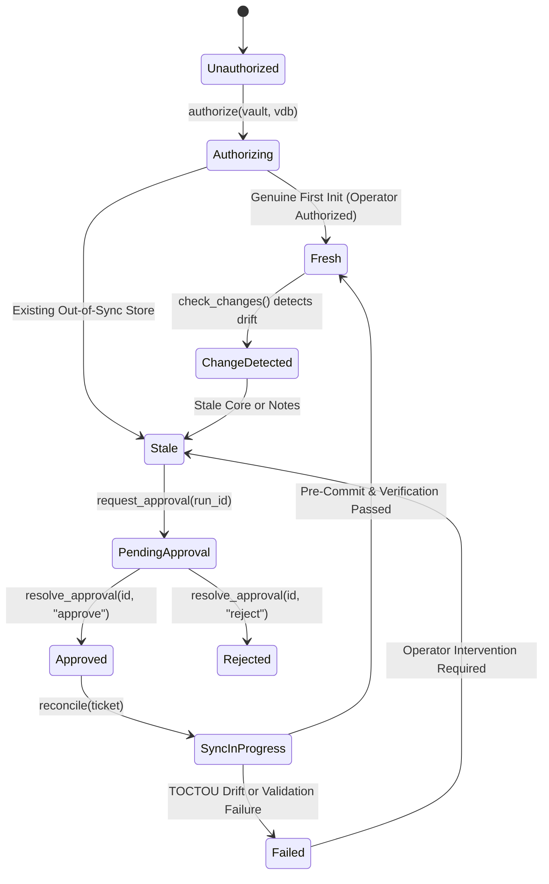

# Authoritative Core Identity and Governed Vector Synchronization Specification

**Status:** Authoritative Architectural Standard
**Document Revision:** 1.2.0
**Baseline Alignment:** Commit `723cc30c73bbbdc2b3b0ac4033c551851c3e86bc`
**Decision Authority:** Human Researcher
**Workstream 1 (WS1 — Concurrent Writer Architecture):** UNAUTHORIZED — NOT STARTED
**Decision Gates 1–6:** PENDING HUMAN AUTHORIZATION

---

## 1. Executive Summary & Purpose

This specification establishes the authoritative, production-grade architecture governing Core knowledge identity, Cold Start lifecycle management, and human-in-the-loop vector database synchronization for LivingAuthenticity AI.

Prior iterations suffered from fragmented architectural reports, historical patch artifacts, and governance deadlocks:
1. Ambiguous identity boundaries between authoritative Core principles and ordinary personal notes.
2. Silent mutation and TOCTOU (time-of-check to time-of-use) risks in vector storage and retrieval.
3. Unverified recovery paths that performed unapproved database writes.
4. Premature concurrency locking mechanisms (Workstream 1) introduced without human architectural authorization.

This document consolidates and supersedes all preceding technical reassessments, providing a single durable source of truth. It defines rigorous fail-closed invariants ensuring that:
- Core identity is deterministically framed, strictly typed, content-integrity hashed, and immutable across runtime transformations.
- Every persistent database modification requires explicit, auditable, operator-authorized tickets, with genuine first initialization strictly governed by explicit operator authorization.
- Retrieval weights authoritative Core knowledge with deterministic, verified mathematical guarantees without leaking provenance to unauthenticated notes.

---

## 2. Authority & Governance Boundaries

### 2.1 The Sole Authority Principle
The Human Researcher remains the sole architectural decision authority for this project. Autonomous agents and subagents are strictly execution vehicles:
- No architectural decision, schema modification, or governance transition may be enacted without explicit human review and approval.
- Staged index modifications, Git commits, and branch operations require explicit human authorization.
- In-flight execution must fail closed immediately upon encountering ambiguous or unapproved states.

### 2.2 Status of Workstream 1 (WS1: Concurrent Writer Architecture)
Workstream 1 (cross-process reader/writer locks, OS file descriptor concurrency controls, multi-writer synchronization) is **STRICTLY UNAUTHORIZED AND NOT STARTED**.
All multi-writer concurrency mechanisms, lock registries, file locking protocols, and associated tests have been removed from the codebase. Single-writer serialized access remains the sole operational baseline until such time as the human researcher formally approves a concurrent architecture.

### 2.3 Status of Architectural Decision Gates 1–6
All six architectural decision gates remain preserved as **PENDING**:
- **Decision Gate 1 (Operational Writer Starvation Boundary):** PENDING. Single-process embedded LanceDB remains the bounded evaluation engine without cross-process writer starvation infrastructure.
- **Decision Gate 2 (Admission Control Architecture):** PENDING. Bounded synchronous access without admission queues or wait-barrier protocols.
- **Decision Gate 3 (Local Reader Batching Policy):** PENDING. Sequential isolated retrieval execution without shared reader lock batching.
- **Decision Gate 4 (Windows Handle Sharing Flags):** PENDING. Standard runtime file access without low-level OS handle sharing flag overrides.
- **Decision Gate 5 (POSIX Backend Strategy & Descriptor Lifecycle Policy):** PENDING. Standard library file descriptor lifecycle without custom POSIX inheritance or flock policies.
- **Decision Gate 6 (Specification Baseline Reconciliation & Implementation Plan Update):** PENDING. Strict adherence to baseline commit `723cc30c73bbbdc2b3b0ac4033c551851c3e86bc`.

---

## 3. Authoritative Core Concept & Identity Specification

### 3.1 Dual-Mode Operation
The system enforces strict behavioral separation between two distinct operating modes:

```
+---------------------------------------------------------------------------------------+
|                                    OPERATING MODES                                    |
+---------------------------------------------------------------------------------------+
|  Vault Mode ("personal_vault")                   |  Test Mode ("examples")             |
|  - Active personal vault root                     |  - Designated fixtures only         |
|  - Schema-driven Core folder ("01 Core")         |  - Fixed bounded integration paths  |
|  - Dynamic folder resolution via schema           |  - Bounded fixture contracts        |
|  - Full human governance lifecycle               |  - No personal note discovery       |
+---------------------------------------------------------------------------------------+
```

### 3.2 Frontmatter Specification & Validation Rules
A note within the authoritative Core folder cannot qualify as Core by mere presence, tags, or file name. It must strictly comply with all frontmatter invariants:
1. `canonical_type`: Must be declared as `"Core"`. Case-insensitive parse matches `"core"`, canonicalized to `"Core"`. Missing `canonical_type` or any other type (`"Observation"`, `"Reflection"`, `"Principle"`) fails closed immediately.
2. `draft`: Must be explicitly declared as a boolean literal: `draft: false`.
   - Missing `draft` is rejected (`CoreFailureCategory.CANONICAL_TYPE_INVALID`).
   - String values (e.g. `draft: "false"` or `draft: "no"`) are strictly rejected.
   - Any truthy value (`draft: true`) disqualifies the note from being authoritative Core.
3. Tags and Content: Tags such as `tags: [core]` cannot substitute for missing or invalid frontmatter.

### 3.3 Stable File Validation & TOCTOU Elimination
To prevent race conditions and concurrent mutation during validation, `_validate_core_note_file()` executes a double-stat check:
- File metadata (`stat()`) and full binary content (`read_bytes()`) are captured prior to YAML frontmatter parsing.
- Following ingestion extraction of knowledge units, the file is re-read and its stat is compared.
- If byte size, modification timestamp (`st_mtime_ns`), or SHA-256 diverges during the pass, validation aborts immediately with `CoreFailureCategory.CHANGED_DURING_PAUSE`.

---

## 4. Core Cold Start Policy & Two-Tier Identity Verification

### 4.1 Fail-Closed Cold Start Invariant
A system initialized without an authoritative, validated Core note must fail closed immediately:
- No execution run may proceed without a certified Core context.
- The system must transition to `run_paused_on_error` with `stop_reason = "core_not_resolved"`.
- It must emit an auditable `CoreResolutionError` with the appropriate category:
  - `MISSING_FOLDER`: The schema-specified Core directory does not exist.
  - `NOTE_NOT_FOUND`: No Markdown file found within the Core directory.
  - `MULTIPLE_ACTIVE`: More than one active Markdown note found in the Core directory.
  - `CANONICAL_TYPE_INVALID`: Missing or invalid `canonical_type` or `draft != false`.
  - `NOTE_EMPTY`: File is 0 bytes or contains only whitespace / frontmatter without body.

### 4.2 Two-Tier Identity Verification Architecture
To ensure zero self-authentication and eliminate impersonation, Core verification operates across two independent tiers:

```
+---------------------------------------------------------------------------------------+
|                        TWO-TIER CORE IDENTITY VERIFICATION                            |
+---------------------------------------------------------------------------------------+
|  Tier 1: Upstream Structural Certification (core_validator.py)                       |
|  - Validates filesystem location, schema compliance, frontmatter, and file stability. |
|  - Ingests text and extracts units into ValidatedCore container.                      |
|  - Attaches process-local private _validator_proof sentinel (_VALIDATOR_PROOF).      |
|  - Computes content integrity SHA-256 of canonical units and file bytes.              |
+-------------------------------------------+-------------------------------------------+
                                            |
                                            v
+---------------------------------------------------------------------------------------+
|  Tier 2: Downstream Mutation Anti-Bypass Guard (LanceDBManager.store())               |
|  - Caller provides candidate unit, metadata claims, and ValidatedCore context.        |
|  - Validates context carries genuine process-local proof and non-tampered unit list.  |
|  - Matches candidate text, source path, and position against validated units.         |
|  - Verifies deterministic record ID matches compute_core_record_id().                 |
|  - Demotes any mismatch to is_core=False, core_hash="", and generates random UUID.     |
+---------------------------------------------------------------------------------------+
```

---

## 5. Content Integrity Hashes, Deterministic IDs & Content Framing

### 5.1 Distinct Protection Boundaries
The architecture maintains explicit distinctions between verification layers:
1. **Content Integrity Hashes:** Deterministic SHA-256 digests over length-prefixed serialized knowledge unit text, note files, manifests, and diffs. Unkeyed SHA-256 digests detect accidental corruption, structural drift, or unintended file mutation against a trusted baseline; however, unkeyed digests do NOT provide cryptographic authenticity against an adversary capable of modifying both content and stored digest.
2. **Deterministic Record Identifiers:** Predictable database primary keys derived via `compute_core_record_id()`. These are deterministic identifiers with negligible collision probability, not mathematically collision-free keys (due to truncation in the record identity formula).
3. **Process-Local Validation-Origin Sentinel:** An internal runtime sentinel object created in process memory (`_VALIDATOR_PROOF = object()`) to verify via identity check (`is _VALIDATOR_PROOF`) that a `ValidatedCore` object was generated by `core_validator.py` within the same runtime process session and was not forged or instantiated directly by ordinary callers (T1). This internal runtime sentinel distinguishes internal runtime validation from casual API misuse, but within a single Python runtime, callers with access to private symbols (T2) can import `_VALIDATOR_PROOF`. In the trusted operational application orchestration path (`Launcher.start_run()`), the runtime independently invokes `validate_and_load_core()` in Step 0 against the physical markdown file in the Obsidian Vault and supplies that genuine anchor to retrieval, causing retrieval to fail closed if an out-of-band forged database hash diverges from the physical vault note. (Direct Retriever verification demonstrates that a Retriever supplied with a genuine validated Core rejects a forged database baseline, while source inspection of `Launcher` confirms that production orchestration executes this validation in Step 0 before retrieval). However, `LanceDBVectorRetriever` does not independently access the filesystem; if a T2 caller constructs the Retriever directly and injects a forged `ValidatedCore`, the Retriever accepts that caller-supplied object as its trust anchor. Protection against same-process programmatic construction ultimately depends on caller provenance and application-level orchestration rather than an autonomous filesystem anchor within the Retriever itself.
4. **In-Memory Approval Tickets:** Runtime dataclass instances (`VaultSyncApprovalTicket`) storing operator-approved diff fingerprints, snapshot fingerprints, and database baseline versions.
5. **Actual Authorization:** The explicit human decision submitted through operator interfaces (CLI/UI).

### 5.2 Deterministic Framing Format
To prevent separator collision and hash ambiguities across knowledge units, `_serialize_unit_text()` employs length-prefixed, boundary-tagged framing:

```
U1:<len(cleaned_text)>:<cleaned_text>|O1:<len(original_text)>:<original_text>|M1:<len(meaning)>:<meaning>|N1:<len(normalized_text)>:<normalized_text>
```

### 5.3 Mandatory Inclusion of Normalized Text
The normalized unit text is an essential component of semantic identity:
- Any alteration to `normalized_text` alters the content framing digest.
- In-memory tampering with a unit's `normalized_text` invalidates validation against `ValidatedCore` fail-closed.
- The unit fingerprint digest is computed via `sha256(framing_bytes).hexdigest()`.

### 5.4 Deterministic Core Record IDs
Core vector records are addressed deterministically rather than via non-deterministic UUIDs. The deterministic record identity is derived via length-prefixed serialization:
```python
serialized = f"{len(core_hash)}:{core_hash}:{len(u_id)}:{u_id}:{len(t_hash)}:{t_hash}:{pos}"
rec_hash = hashlib.sha256(serialized.encode("utf-8")).hexdigest()
core_rec_id = f"core_vec_{core_hash[:8]}_{u_id}_{rec_hash[:16]}"
```
- **Collision Resistance:** Truncation of SHA-256 digests (`core_hash[:8]` and `rec_hash[:16]`) produces deterministic identifiers with negligible collision probability under normal operational scale, rather than mathematically collision-free keys.
- Only genuine Core units validated by Tier 1 and verified by Tier 2 may receive this deterministic ID.
- Any unauthorized caller passing `record_id` prefixed with `core_vec_` without meeting Tier 2 criteria has its ID discarded and replaced with a randomly generated UUID.

---

## 6. Vector Database Architecture & Anti-Bypass Protections

### 6.1 Database Schema & Metadata Invariants
The persistent LanceDB store maintains two primary tables:
1. `knowledge_vectors`:
   - `id`: String (deterministic `core_vec_*` for Core, UUID for ordinary notes).
   - `text`: String (cleaned / original unit text).
   - `source`: String (normalized source note path relative to vault root).
   - `position`: Int32 (zero-based unit position within source file).
   - `embedding`: Vector[1024, Float32].
   - `is_core`: Boolean (strictly True for Core, False for all others).
   - `core_hash`: String (SHA-256 content integrity hash of authoritative Core, empty string for non-core).
2. `index_metadata`:
   - `id`: String (`"meta"`).
   - `payload`: JSON string storing authoritative sync state, manifest snapshot, vault ID, and baseline version.

### 6.2 The Store Anti-Bypass Verification Algorithm
`LanceDBManager.store()` operates as an independent security boundary. Even if an upstream component is compromised or buggy, `store()` independently verifies:
```python
if validated_core is not None and metadata.get("is_core") is True:
    # 1. Verify process-local validation context proof
    # 2. Match unit source, position, and text against validated_core.units
    # 3. Match source against validated_core.path
    # 4. Match core_hash against validated_core.sha256
    # 5. Verify record_id matches compute_core_record_id()
```
If any check fails, the record is stored as an ordinary unit with `is_core=False` and `core_hash=""`.

---

## 7. Governed Vector Synchronization Lifecycle

Persistent vector store mutations must follow a strict, human-in-the-loop state machine:



### 7.1 Authorize & Initial Synchronization Privilege
The explicit operator call to `authorize(vault_root, vector_db_root, embedder)` constitutes the sole authorized entry point for initialization:
- **Genuine First Initialization Exception:** When `_is_genuine_first_init()` verifies that the persistent store is completely empty (`vector_count == 0` and no existing `index_metadata` table), initial synchronization privilege (`_initial_sync_active = True`) is granted for that single initialization attempt.
- `authorize()` triggers `reconcile()`. If reconciliation succeeds and certifies Fresh, the store enters service.
- **Initial Sync Rollback & Cleanup Verification:** If initial reconciliation fails, drifts, or aborts, `_rollback_initial_sync()` attempts to drop created tables (`index_metadata`, `knowledge_vectors`) and executes fallback row deletion (`delete("id IS NOT NULL")` and `delete_all()`). It then verifies whether the store was genuinely restored to an empty state:
  - If post-cleanup inspection confirms `state == "genuine_first_init"`, `vector_count == 0`, `has_metadata_table == False`, and no cleanup errors occurred, rollback is certified `verified_clean`.
  - If cleanup fails, raises exceptions, or leaves residual vectors or metadata, `authorize()` raises `VaultSyncRollbackError` (chaining the original error and attaching `cleanup_errors` and `store_state`) or returns a failed report with `rollback="failed"`, `rollback_verified=False`, and `recovery_state="uncertain_store_state"`. Under no circumstances is an unverified or dirty store reported clean.
- **Subsequent Privilege Denial:** A store in an uncertain, dirty, or unverified state (`missing_metadata`, `corrupted_metadata`, or residual rows) is strictly denied initial synchronization privilege on subsequent `authorize()` calls. Explicit human recovery or store reset is required fail-closed.
- **Existing Store Invariant:** If `_is_genuine_first_init()` is False (the store is already populated, has existing metadata, or is in an invalid/corrupted state), initial synchronization privilege is strictly refused. `authorize()` only initializes runtime session state and inspects store freshness. Any persistent write requires an explicit `VaultSyncApprovalTicket`.

### 7.2 Check Changes
`check_changes(snapshot=None)` takes a consistent filesystem snapshot, compares against baseline manifest, and inspects vector records for missing or stale Core units.

### 7.3 Request & Resolve Approval
`request_approval(run_id, ttl_seconds)` derives `current_snapshot`, computes `snapshot_fingerprint`, and binds the request to `diff_fingerprint`. Operator explicitly approves or rejects.

### 7.4 Reconcile
`reconcile(ticket)` requires an approved, unexpired, unused ticket (unless running within the initial synchronization privilege). It enforces:
- Snapshot fingerprint equality.
- Core hash equality.
- Change set `diff_fingerprint` equality.
- Database baseline version equality.

---

## 8. Approval Ticket Semantics & Invariants

An approval ticket is an in-memory runtime authorization object (`VaultSyncApprovalTicket`):
- `ticket_id`: Unique UUID.
- `vault_id`: Bound to the specific vault identifier.
- `snapshot_fingerprint`: SHA-256 digest of the complete directory manifest.
- `core_hash`: SHA-256 digest of the active Core note.
- `diff_fingerprint`: SHA-256 digest of sorted added, modified, and removed path lists.
- `database_baseline_version`: Monotonic table version recorded at approval time.
- `expires_at`: Epoch timestamp after which the ticket is rejected fail-closed.
- `used`: Single-use boolean flag transitioned to True upon execution.

---

## 9. Change Detection & Case A / Case B Separation

### 9.1 Case A: Missing Core Record Recovery
When filesystem changes are zero and the Core file hash matches the stored manifest, but vector rows in `knowledge_vectors` are missing:
- `check_changes` reports `case_a_eligible = True`.
- **Fail-Closed Governance Invariant:** Case A recovery **CANNOT** run automatically without a ticket. Persistent database writes require an operator approval ticket.
- Upon ticket approval, `_recover_missing_core_records()` inserts missing Core vectors non-destructively without modifying baseline manifest or touching ordinary notes.

### 9.2 Case B: Normal Change Reconciliation
When filesystem changes exist (added, modified, or removed files) or Core hash has changed:
- Incremental reconciliation or clean rebuild is planned.
- Requires operator approval ticket.
- Applies deletions and ingestions, followed by mandatory pre-commit verification.

---

## 10. Atomic Re-Validation & Table Version Integrity

### 10.1 Live Table Version Checking
`LanceDBVectorRetriever` inspects the vector table version before and after query execution:
- Re-reads live table version from storage.
- If the version increments or diverges during retrieval, retrieval aborts immediately with `DatabaseOperationError("Store mutated during retrieval: fail closed")`.

### 10.2 Pre-Commit TOCTOU Verification
Before committing metadata certifying the store as Fresh, `VaultSyncSession`:
- Re-snapshots the vault filesystem.
- Verifies every processed file's SHA-256 on disk matches the snapshot.
- Revalidates Core note on disk.
- Fails closed if any disk mutation occurred during synchronization.

---

## 11. Retrieval Weighting, Database Baseline Integrity & Semantic Invariants

### 11.1 Default Weighting Factor
The default `core_boost_factor` in `LanceDBVectorRetriever` is set to:
$$\text{core\_boost\_factor} = 0.30$$
The effective relevance multiplier applied to verified Core candidates is:
$$\text{multiplier} = 1.0 + \text{core\_boost\_factor} = 1.30\times$$

### 11.2 Verification Requirements for Boost Application
The boost is applied in `_ranking_key` strictly if:
1. Retrieval verifies the vector database baseline integrity (`_verify_core_database_baseline_integrity`).
2. Candidate declares `is_core = True`.
3. Candidate `core_hash` is non-empty and matches `validated_core.sha256`.
4. Candidate source path matches `validated_core.path`.
5. Retriever holds a verified `ValidatedCore` context.

Unverified candidates, ordinary notes, or candidates from a database failing baseline verification never receive the boost, regardless of metadata flags.

### 11.3 Approved Baseline Integrity Model & Content Digest (`core_vector_digest`)
Prior to Phase 3 Final Integrity Verification, the retriever only checked whether the table version changed during query execution (`_check_store_version(initial_version)`). It did not verify whether embeddings had been tampered with out-of-band prior to query arrival.

To close this architectural gap, the system implements the **Approved Baseline Integrity Model**:
$$\text{Authorized Core Validation} \longrightarrow \text{Human-Approved Synchronization} \longrightarrow \text{Persisted Integrity Baseline} \longrightarrow \text{Live Database Verification} \longrightarrow \text{Trusted Retrieval}$$

1. **Deterministic Canonical Vector Digest (`core_vector_digest`):**
   - The digest is computed by `compute_core_vector_digest(core_records)`.
   - Records are deterministically ordered by record ID (`core_vec_...`).
   - For every record, canonical serialized representations of identity-bearing and semantic fields are concatenated: `id`, `source`, `position`, `text`, `is_core`, `core_hash`, and IEEE 754 float32 little-endian byte array hex of the `embedding` (or `vector`) vector.
   - **Canonical Float32 Little-Endian Encoding:** The embedding vector is explicitly cast to little-endian float32 (`np.dtype("<f4")`) prior to `.tobytes().hex()`, guaranteeing deterministic cross-platform hash identity regardless of host machine architecture or native byte order.
   - **Strict Non-Finite Value Rejection:** Any non-finite float value (`NaN`, `+Inf`, `-Inf`) in an embedding vector immediately raises `ValueError("Non-finite float value detected in Core embedding vector (NaN or Inf)")`, preventing non-deterministic NaN bit patterns from corrupting digest calculations.
   - **Exact Stored Text Preservation:** `text` is extracted and hashed exactly as stored in the database without calling `.strip()`. Leading, trailing, and internal whitespace variations are fully preserved, ensuring that whitespace tampering alters the SHA-256 digest.
   - The SHA-256 digest of this canonical payload is persisted in `index_metadata` alongside `core_vector_count` and `core_record_ids`.

2. **Authorized Baseline Establishment & Certification Authority:**
   - **Separation of Validation Proof, Human Approval, and Sync Authorization:**
     - **Core Validation Proof:** Validates the singleton Core note on disk (schema compliance, frontmatter integrity, active status, unit extraction, and provenance binding), producing `ValidatedCore` with a private process-local capability token (`_VALIDATOR_PROOF`). This proves that the Core content is structurally and semantically authentic; it does NOT grant permission to mutate the database or certify a baseline.
      - **Human Approval & Ticket Provenance Binding:** When changes to the Core or vault occur, an operator review lifecycle generates an `ApprovalTicket` (`VaultSyncApprovalTicket`) bound to the vault ID, snapshot fingerprint, and Core hash. Human review and explicit approval are required before reconciliation can begin. Ordinary callers cannot manufacture trusted tickets through the public constructor (which always initializes internal proof to `None`); genuine approval tickets can only be minted via `VaultSyncApprovalTicket._issue_approved_ticket()` called within `VaultSyncSession.resolve_approval(decision="approve")`. To prevent callers holding a session reference from invoking `_issue_approved_ticket()` directly:
        - `resolve_approval()` generates a single-use private `issuance_nonce = object()`, which is temporarily attached to `session._current_issuance_nonce` during issuance and cleared immediately in a `finally` block.
        - `_issue_approved_ticket()` validates that the caller provides both the session and the private `issuance_nonce`, failing closed if called outside active `resolve_approval()` execution.
        - The issuing session records genuine approved tickets in both `_issued_tickets` (by object ID) and `_approved_tickets_by_id` (by ticket ID), accompanied by an immutable audit entry in `_approval_history`.
        - `session.is_ticket_issued_by_session(ticket)` performs a strict three-point validation: verifying `id(ticket) in _issued_tickets`, identity equality `_approved_tickets_by_id.get(ticket.ticket_id) is ticket`, and verifying that the ticket's approval ID, run ID, and core hash match the session's recorded approval history. Any fabricated ticket, copied attributes, or alien session ticket fails closed.
      - **Sync Authorization Capability Factory (`create_sync_authorization`):** During authorized execution of `reconcile()` in `VaultSyncSession`, the session mints an immutable `SyncAuthorizationContext` carrying a private process-local capability token (`_SYNC_AUTH_PROOF`). This capability factory enforces rigorous process-local capability verification:
        - **Dynamic Single-Use Minting via Factory Invocation Proof:** Public construction `SyncAuthorizationContext(...)` sets `_sync_proof = None`. Valid contexts can only be minted via `SyncAuthorizationContext._mint_authorized_context(...)` executing inside `create_sync_authorization()`. Static secret passing (such as importing module-level `_AUTH_FACTORY_SECRET`) is explicitly rejected. The factory dynamically establishes an ephemeral single-use invocation record (`_ACTIVE_FACTORY_INVOCATION`) bound to thread ID, vault ID, session ID, ticket ID, and Core hash under `_AUTH_REGISTRY_LOCK`. Minting verifies the caller frame (`create_sync_authorization`), matching thread ID, and exact parameter bindings, atomically consuming the invocation proof immediately upon context creation.
        - **Active Registry & Upfront Atomic Claim-and-Consume:** Minted contexts are registered in a module-level `_ACTIVE_SYNC_AUTHORIZATIONS` dictionary protected by `_AUTH_REGISTRY_LOCK`. Rather than deferred consumption after persistence, `LanceDBManager.save_metadata()` invokes `claim_and_consume_sync_authorization()` *upfront* prior to baseline calculation or disk write. This atomically validates the capability token, verifies exact identity bindings (`expected_core_hash`, `expected_vault_id`, `expected_session_id`, `expected_ticket_id`), and marks `consumed = True` in a single locked transaction, completely eliminating Time-Of-Check to Time-Of-Use (TOCTOU) race windows between concurrent callers.
        - **Fail-Closed Persistence Failure Semantics:** If database persistence fails after upfront consumption (e.g. storage error, schema failure), the capability token *remains consumed*. Replay, reuse, or retry with the same context is strictly prohibited to guarantee state isolation and prevent split-brain baseline certification.
        - **Single-Use Approval Ticket Nonce & Atomic Consumption:**
          - `resolve_approval()` generates a single-use private `issuance_nonce = object()`, attached to `session._current_issuance_nonce`.
          - `_issue_approved_ticket()` acquires `session._lock`, verifies the active nonce, and *atomically consumes* it (`session._current_issuance_nonce = None`) on first use. Any second or concurrent invocation with the same nonce fails closed immediately with `ValueError`.
        - **Atomic Thread Synchronization & Re-entrancy Protection:**
          - `VaultSyncApprovalTicket._lock` uses a `threading.RLock()` (re-entrant lock) to prevent thread self-deadlock when the ticket's `is_consumed` property is evaluated while holding the lock.
          - Issuance inside `create_sync_authorization()` executes under `with ticket._lock:` and asserts that `ticket._issuance_in_progress` is False before setting it to True, failing closed with typed `ValueError` if concurrent or re-entrant issuance is attempted.
          - For initial cold-start sync, issuance executes under `with session._lock:` and asserts that `session._initial_issuance_in_progress` is False before setting it to True.
        - **Session Authenticity:** `is_trusted_vault_sync_session(session)` verifies that `session` is an authentic, genuine `VaultSyncSession` carrying the internal `_session_proof` sentinel. Fabricated session objects or objects copying public attributes are rejected.
        - **Ticket Provenance & Authenticity:** `is_trusted_approval_ticket(ticket, session=session)` verifies that `ticket` was authentically minted by `resolve_approval()`, carries the internal `_ticket_proof` sentinel, has `decision == "approve"`, and is verified by `session.is_ticket_issued_by_session(ticket)`.
        - **Fail-Closed Validation Order:** Checks are ordered strictly from identity provenance to lifecycle state: ticket validity -> decision -> expiration -> Core hash -> Vault ID -> Session ID -> session issuance provenance -> ticket consumption (`is_consumed`) -> single issuance (`_authorization_issued`) -> session reconciliation state (`status == SYNC_STATE_IN_PROGRESS`) -> matching active reconciliation ticket.
        - **Lifecycle Ordering & Safe Consumption:** The reconciliation lifecycle safely orders: metadata persistence -> immediate ticket consumption (`auth_ticket.mark_consumed()`) -> clearing active reconciliation ticket (`_current_reconciliation_ticket = None`) -> status transition to `SYNC_STATE_FRESH`.
     - **Baseline Certification in `save_metadata()`:** Establishing or replacing the Core database baseline (`core_vector_digest`, `core_vector_count`, `core_record_ids`, `core_hash`, `core_source_path`, `vector_table_version`) requires BOTH an authoritative `ValidatedCore` AND a valid matching `SyncAuthorizationContext`.
     - **Fail-Closed Baseline Defense:**
       - If `validated_core` is provided without valid `sync_auth`: `save_metadata()` fails closed immediately with `DatabaseOperationError("Core baseline certification requires valid, authorized synchronization evidence")`.
       - If `sync_auth` is provided without `validated_core`: fails closed immediately (`DatabaseOperationError`).
       - If `sync_auth` is forged (booleans, strings, plain dicts, forged objects), expired, already consumed, or its `core_hash` does not match `validated_core.sha256`: fails closed immediately (`DatabaseOperationError`).
       - If neither is provided (generic metadata update): `save_metadata()` strictly preserves existing trusted baseline fields if a baseline exists, or strips baseline keys if no baseline exists yet. A generic call can never create or alter a baseline.

3. **Pre-Retrieval TOCTOU Window Closure & Double Version Snapshot:**
   In `LanceDBVectorRetriever.retrieve()`:
   - **Pre-Verification Version Snapshot:** The initial live vector table handle is acquired (`table = self._db_manager.get_table()`) and its version (`table.version`) is captured as `v_pre`. If missing, None, or empty, retrieval fails closed immediately (`DatabaseOperationError`).
   - **Baseline Integrity Execution:** Content-fingerprint-bound vector digest and structural verification are executed against the table state under snapshot `v_pre`.
   - **Independent Post-Verification Snapshot Reacquisition:** The live table handle is reacquired independently via `self._db_manager.get_table()`.
     - If reacquisition throws an exception, retrieval stops immediately with `DatabaseOperationError`, preserving the original exception as its cause (`from exc`).
     - If the returned handle is `None`, retrieval stops immediately with `DatabaseOperationError`.
     - If the post-check version (`v_post`) is missing, None, or empty, retrieval stops immediately with `DatabaseOperationError`.
     - Under NO circumstances is there a silent fallback to the previous table reference (`table`) or to cached state. Reusing the first snapshot reference is strictly forbidden.
   - **TOCTOU Version Comparison:** The system verifies `v_pre == v_post`. If versions differ, retrieval fails closed immediately (`DatabaseOperationError("Store mutated during baseline verification: fail closed")`).
   - **In-Flight Anchor & Query Usability:** The verified post-check table handle (`live_tbl_post`) and version (`v_post`) are used as `initial_version` for all subsequent operations. If the table lacks a `search` method attribute (B6-A) or has a non-callable `search` attribute (B6-B), retrieval fails closed immediately with typed `DatabaseOperationError("Reacquired vector table lacks callable search method")`. If search execution throws an underlying storage or indexing exception (B6-C), retrieval fails closed with typed `DatabaseOperationError("Vector search failed: ...")` preserving causal exception chaining (`from search_exc`), without fallback to stale or unverified data, without Core boost, and with diagnostic failure telemetry.

4. **Exact ValidatedCore Hash Binding:**
   In `LanceDBVectorRetriever._verify_core_database_baseline_integrity()`:
   - When `self.validated_core` is configured on the retriever, `val_hash = self.validated_core.sha256` must be a valid non-empty string.
   - If `"core_hash"` is missing from metadata: fails closed immediately (`VaultMetadataMissingError`).
   - If `meta["core_hash"]` is None, empty string, non-string, or whitespace-only: fails closed immediately (`VaultMetadataCorruptionError`).
   - If `meta["core_hash"] != val_hash`: fails closed immediately (`DatabaseOperationError`).
   - Falsy evaluations can never bypass hash verification.
   - **Orchestrated Retrieval vs. Direct Construction Boundary:**
     - **A. Trusted Application Orchestration (`Launcher.start_run()`):** The operational `Launcher` independently invokes `validate_and_load_core()` during preflight (Step 0) against the physical Vault on disk and supplies that genuine `ValidatedCore` to the Retriever. If an adversary has forged or manipulated the database baseline (`meta["core_hash"]`), the hash mismatch is detected and retrieval fails closed, preserving the physical Vault note as the out-of-band anchor. (Direct Retriever verification in `test_t2_4` demonstrates this fail-closed rejection when the Retriever receives a genuine Core, while source inspection of `Launcher._execute_run()` confirms this preflight check is executed in Step 0 of application runs).
     - **B. Direct Same-Process Retriever Construction:** `LanceDBVectorRetriever` accepts an injected `ValidatedCore` and does not independently access the filesystem. A caller with T2 capabilities can construct a forged `ValidatedCore` and supply it directly; because the Retriever compares the database against the caller-supplied object, the physical Vault is NOT an independent trust anchor in this direct-construction path.

5. **Dual Fail-Closed Operational Modes:**
   - **Safe Operational Mode (`raise_on_integrity_error=False`, Default):** Retrieval queries complete gracefully without crashing user interfaces, but demote all Core records to unverified (`is_core = False`, `core_hash = ""`), strip ranking boosts (1.0x multiplier), and record `core_baseline_verified = False`, `core_trusted = False` in result telemetry.
   - **Strict Validation Mode (`raise_on_integrity_error=True`):** Aborts retrieval immediately, raising typed exceptions (`DatabaseOperationError`, `VaultMetadataMissingError`, or `VaultMetadataCorruptionError`).

### 11.4 Threat Model, Trust Boundaries & Cryptographic Limitations
1. **Threat Model Capabilities & Attacker Tiers:**
   - **T1 — Ordinary External Caller (Protected):** Uses public APIs (`VaultSyncSession`, `LanceDBManager.save_metadata()`, `LanceDBVectorRetriever.retrieve()`).
     - *Boundary Controls:* Fail-closed parameter validation, double version snapshots (`v_pre == v_post`), lifecycle state checks, and public constructor nullification (`_sync_proof = None`, `_ticket_proof = None`).
     - *Guarantees:* Ordinary callers cannot manufacture valid tickets, mint authorization contexts, or establish/mutate baseline fields.
   - **T2 — Caller With Access to Private Python Symbols (Demonstrated In-Process Authorization Forgery Limitation):** Can import underscore-prefixed symbols (`_AUTH_FACTORY_SECRET`, `_SESSION_PROOF`, `_TICKET_PROOF`, `_VALIDATOR_PROOF`), instantiate classes via `__new__`, and assign accessible Python object attributes.
     - *Boundary Controls:* Dynamic ephemeral execution proof (`_ACTIVE_FACTORY_INVOCATION`), caller-frame inspection inside `create_sync_authorization()`, single-use ticket nonce consumption under `session._lock`, and upfront atomic claim-and-consume in `save_metadata()`.
     - *Specific Protections Enforced:* Ordinary API misuse, naive un-invoked direct instantiation of `SyncAuthorizationContext`, and replay or reuse of legitimately consumed authorization contexts are rejected.
     - *Demonstrated Trust Limitation (In-Process State Reconstruction & Authorization Forgery):* Same-process object graph reconstruction remains a demonstrated architectural limitation. In a single Python runtime without memory isolation, process-local sentinels and mutable attributes cannot distinguish between an object graph populated through legitimate lifecycle methods and an object graph reconstructed programmatically. A T2 caller with private-symbol access can instantiate `VaultSyncSession` and `VaultSyncApprovalTicket` via `__new__`, assign sentinel proofs, populate internal session registries, invoke the genuine `create_sync_authorization()` factory, and obtain a genuine, registered `SyncAuthorizationContext`. With that context, the caller can execute `save_metadata()` to write an unapproved Core baseline to the database without genuine human approval. T2 authorization forgery is NOT fully prevented by process-local controls.
     - *Mitigation & Defense-in-Depth (Application Orchestration):* When retrieval is orchestrated through the production entrypoint (`Launcher.start_run()`), the operational `Launcher` independently executes `validate_and_load_core()` in Step 0 targeting the physical Obsidian Vault markdown note on disk. An ordinary caller cannot supply an external `ValidatedCore` to `start_run()`. Under this orchestration boundary, if an adversary has forged or tampered with the database baseline out-of-band, retrieval fails closed immediately upon mismatch with the genuine vault note (demoting Core chunks and stripping boosts in default safe mode, or raising `DatabaseOperationError` in strict mode). Note that while direct Retriever tests (`test_t2_4`) verify that a Retriever supplied with a genuine Core rejects a manipulated database baseline, production end-to-end integration relies on `Launcher` preflight orchestration.
     - *Verified Trust Limitation (Direct Retriever Construction):* `LanceDBVectorRetriever` itself does not autonomously access or verify against the physical filesystem; it inherits its trust anchor from the `validated_core` object supplied to its constructor or `set_validated_core()`. A T2 caller directly instantiating `LanceDBVectorRetriever` and supplying a forged `ValidatedCore` (constructed using `_VALIDATOR_PROOF`) will have that forged Core accepted as the active trust anchor: `core_baseline_verified` and `core_trusted` evaluate to True, and Core ranking boosts are applied. The physical Obsidian Vault note is an independent trust anchor for the application's orchestrated pipeline, but direct Retriever construction remains caller-trust-dependent. Full protection against in-process state reconstruction requires out-of-band trust roots (OS-level process isolation, external approval daemon, or asymmetric cryptographic signatures) which remain outside Phase 3 scope.
   - **T3 — Arbitrary Malicious Code Inside the Same Python Process (Explicitly Outside Security Boundary):** An adversary with arbitrary code execution inside the Python runtime (e.g., monkey-patching functions, mutating module dictionaries directly, or inspecting heap objects via `gc.get_objects()` or `ctypes`).
     - *Explicit Non-Guarantee:* Python does not provide in-process memory isolation or kernel-level security boundaries between code running in the same interpreter. Sentinels, locks, caller-frame checks, and internal registries establish rigorous structural contracts and prevent architectural bypasses, but they do NOT protect against arbitrary malicious code executing inside the same process. Protection against T3 requires OS-level process isolation, containerization, or sandboxing outside the application runtime.
   - **Ordinary Note Policy Boundary (Core-Only vs. Whole-Table Policy):** Baseline integrity specifically binds Core-owned records (`is_core = True`). Incremental synchronization, modification, or addition of ordinary notes in `knowledge_vectors` does not alter Core records and therefore does not invalidate Core baseline trust or halt retrieval.
2. **Cryptographic Trust Limitations:**
   - The integrity baseline relies on an unkeyed SHA-256 digest stored in `index_metadata` alongside the vector table.
   - It is **not** an asymmetric cryptographic signature (e.g., Ed25519) rooted in an external hardware security module (HSM) or private key.
   - If an adversary gains local write privileges to the storage medium and rewrites *both* the LanceDB table AND the `index_metadata` payload synchronously with a matching valid recomputed SHA-256 digest, unkeyed software digests cannot distinguish between legitimate operator synchronization and malicious offline re-indexing.
   - To mitigate this boundary, runtime retrieval orchestrated through the application entrypoint binds `index_metadata.core_hash` to the separately validated in-memory `ValidatedCore` object anchored in the Obsidian Vault. An attacker cannot forge active Core authority in application runs without also mutating the authoritative markdown note in the Obsidian Vault, which requires operator approval. However, standalone `LanceDBVectorRetriever` instances directly instantiated by callers do not independently consult the Obsidian Vault and inherit whatever `ValidatedCore` is supplied to them.


3. **Python Process-Local Security Boundaries & Threat Model Limitations:**
   - Capability sentinels (`_SYNC_AUTH_PROOF`, `_AUTH_FACTORY_SECRET`, `_TICKET_PROOF`, `_VALIDATOR_PROOF`), synchronization locks (`threading.RLock`), and active authorization registries are in-memory, Python process-local constructs.
   - In standard Python runtimes, private attributes, closures, and object references share the same address space. Introspection (`getattr`, `__dict__`, `gc.get_objects()`) or reflection can inspect and mutate in-memory references if arbitrary untrusted Python code executes within the same process.
   - These defenses provide strict structural boundaries and fail-closed capability segregation against architectural bypasses, improper caller sequences, concurrency races, and untrusted component interactions within the application runtime.
   - They do **not** represent cross-process kernel-level security boundaries, hardware-enforced memory isolation, or protection against remote code execution (RCE) / arbitrary code execution occurring inside the local process.
---

## 12. Durability, Audit Logging & Post-Write Verification

### 12.1 Audit Durability
All synchronization events, approvals, rejections, and errors are written to an append-only audit trail (`AuditWriter`):
- High-priority operational events emit sanitized JSONL records.
- If primary audit persistence fails, fallback emergency logging (`EMERGENCY_LOG_FILENAME`) is engaged.
- Audit records include monotonic identifiers, session IDs, run IDs, and terminal outcomes.

### 12.2 Post-Write Verification
Following insertion of vectors during Case A or Case B reconciliation, the store queries existing IDs:
- All expected Core IDs must be a subset of stored IDs.
- Total vector row count must match candidate metadata `indexed_vectors`.
- If verification fails, store is marked `SYNC_STATE_STALE` and fresh certification is refused.

---

## 13. Error Hierarchy & Fail-Closed Failure Semantics

```
Exception
├── CoreResolutionError
│   └── (Categories: MISSING_FOLDER, NOTE_NOT_FOUND, MULTIPLE_ACTIVE,
│        CANONICAL_TYPE_INVALID, NOTE_EMPTY, INACCESSIBLE, CHANGED_DURING_PAUSE)
├── DatabaseError
│   ├── DatabaseOperationError
│   └── DatabaseLockError
├── VaultMetadataError
│   ├── VaultMetadataMissingError
│   └── VaultMetadataCorruptionError
└── VaultSyncError
    ├── VaultSyncUnauthorizedError
    ├── VaultSyncStaleApprovalError
    ├── VaultSyncSnapshotDriftError
    ├── VaultSyncRollbackError
    └── VaultSyncConcurrencyError
```

All errors fail closed, preventing partially initialized or unverified data from being used in analysis or decision proposals.

---

## 14. Test Suites & Verification Matrix

| Test Suite File | Focus Area | Invariants Verified |
|---|---|---|
| `tests/retrieval/test_retrieval_concurrency_and_version_invariants.py` | Table Version Invariants | Out-of-band mutation detection, live table version fail-closed, exception safety. |
| `tests/vault/test_generic_indexing_governance.py` | Generic Indexing Governance | Operational metadata isolation, unverified store protection, manifest immutability. |
| `tests/vault/test_vault_sync_authorization_lifecycle.py` | Governed Sync Lifecycle | Ticket validation, diff fingerprint matching, Case A/B separation, approval expiration. |
| `tests/vault/test_core_identity_and_retrieval_lifecycle.py` | Core Provenance, Retrieval & Baseline Integrity | Length-prefixed framing, normalized_text tampering, stable file checks, 1.30x boost, Tests A through H (out-of-band embedding/metadata mutations, count/ID verification, process restarts, legacy database fail-closed, real obsolete V1 candidate rejection), TestPhase3TargetedIntegrityCorrections (Corrections A, B, C, D, E), TestPhase3SyncAuthorizationFactoryHardening (Tests F12-F16), TestPhase3FinalAuthorizationProvenanceAndAtomicIssuance (Tests A1-A6, C1-C6, R1-R5), and T2 Session/Ticket Forgery & Direct Retriever Anchor Verification (Tests T2-1 to T2-5). |
| `tests/vault/test_cold_start_governance.py` | Cold Start Resilience | Fail-closed startup, pause-and-resume workflows, operator recovery provenance. |
| `tests/retrieval/test_lancedb_retriever.py` | Store Anti-Bypass | 8 adversarial direct-call tests on store(), 1.30x boost calculation. |

---

## 15. Architectural Non-Goals & Future Scope Boundaries

### 15.1 Workstream 1 Non-Goals
Multi-process concurrent writers, file-descriptor lock registries, and shared file locking protocols are explicitly out of scope and unauthorized. No multi-writer logic may be added without human approval.

### 15.2 Decision Gates 1–6 Preservation
All six canonical architectural decision gates remain strictly preserved as **PENDING** human researcher authorization:
1. **Decision Gate 1 (Operational Writer Starvation Boundary):** PENDING. Single-process embedded LanceDB remains the bounded evaluation engine without cross-process writer starvation infrastructure.
2. **Decision Gate 2 (Admission Control Architecture):** PENDING. Bounded synchronous access without admission queues or wait-barrier protocols.
3. **Decision Gate 3 (Local Reader Batching Policy):** PENDING. Sequential isolated retrieval execution without shared reader lock batching.
4. **Decision Gate 4 (Windows Handle Sharing Flags):** PENDING. Standard runtime file access without low-level OS handle sharing flag overrides.
5. **Decision Gate 5 (POSIX Backend Strategy & Descriptor Lifecycle Policy):** PENDING. Standard library file descriptor lifecycle without custom POSIX inheritance or flock policies.
6. **Decision Gate 6 (Specification Baseline Reconciliation & Implementation Plan Update):** PENDING. Strict adherence to baseline commit `723cc30c73bbbdc2b3b0ac4033c551851c3e86bc`.

---

## 16. Reference Implementations & Schema Definitions

### 16.1 Length-Prefixed Serialization Reference
```python
def _serialize_unit_text(unit: KnowledgeUnit) -> bytes:
    clean = (getattr(unit, "cleaned_text", None) or "").strip()
    orig = (getattr(unit, "original_text", None) or "").strip()
    meaning = (getattr(unit, "meaning", None) or "").strip()
    norm = (getattr(unit, "normalized_text", None) or "").strip()

    c_b = clean.encode("utf-8")
    o_b = orig.encode("utf-8")
    m_b = meaning.encode("utf-8")
    n_b = norm.encode("utf-8")

    return (
        f"U1:{len(c_b)}:".encode("ascii") + c_b +
        f"|O1:{len(o_b)}:".encode("ascii") + o_b +
        f"|M1:{len(m_b)}:".encode("ascii") + m_b +
        f"|N1:{len(n_b)}:".encode("ascii") + n_b
    )
```

### 16.2 Diff Fingerprint Reference
```python
def compute_diff_fingerprint(diff: dict) -> str:
    canonical = {
        "added": sorted([p.replace("\\", "/") for p in diff.get("added", [])]),
        "modified": sorted([p.replace("\\", "/") for p in diff.get("modified", [])]),
        "removed": sorted([p.replace("\\", "/") for p in diff.get("removed", [])]),
    }
    raw = json.dumps(canonical, sort_keys=True, separators=(",", ":")).encode("utf-8")
    return hashlib.sha256(raw).hexdigest()
```
