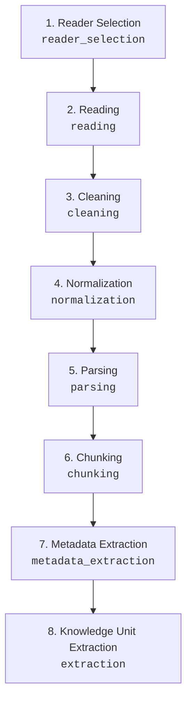
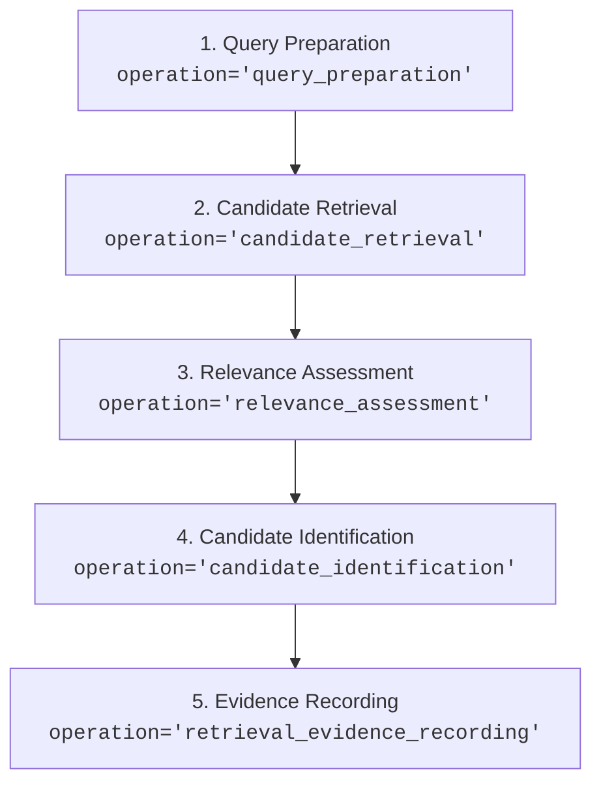
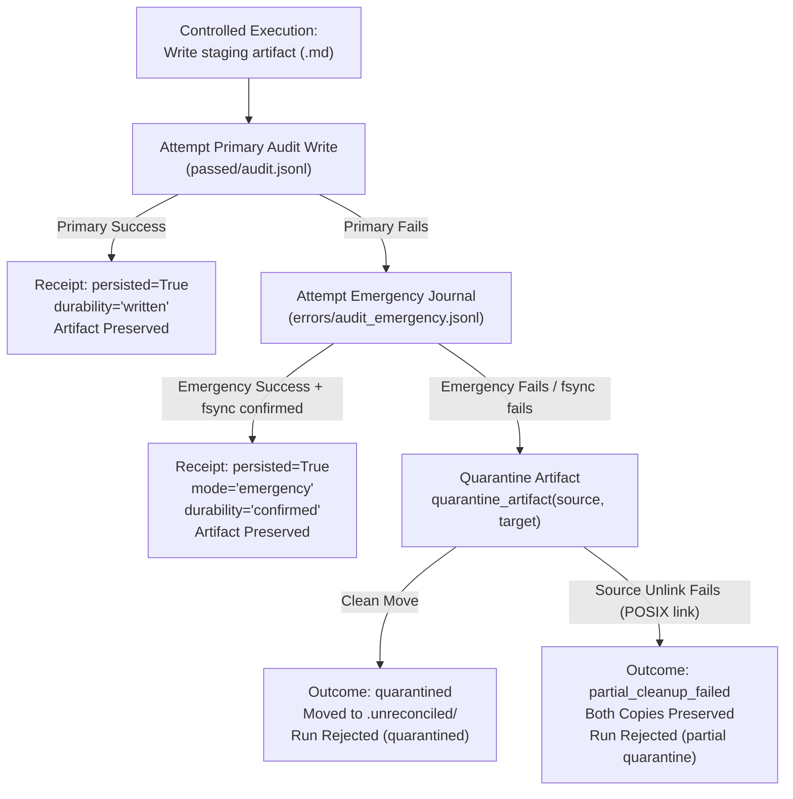

# Input & Ingestion Pipeline Architecture, Live Reporting, and Recovery Workflow

**Modules:** `src.living_authenticity.knowledge.input.processor`, `src.living_authenticity.knowledge.ingestion.pipeline`, `src.living_authenticity.knowledge.ingestion.readers`<br/>
**UI Components:** `Composer`, `ProcessingResult`, `CurrentAudit` (`frontend/src/components/Panels.tsx`)<br/>
**Adapter:** `src.living_authenticity.adapter.app`<br/>
**Status:** Authoritative Foundation

---

## 1. Overview and Responsibility

The Input stage is the single authoritative entry gate of the LivingAuthenticity Knowledge Management loop. It provides an ergonomic, zero-latency in-UI chat composer for the researcher, backed by rigorous backend validation, noise detection, privacy guards, and an interactive recovery workflow.

```text
[Composer UI] (In-place, UTF-8 byte check, draft preservation)
     │
     ▼ POST /api/run
[Adapter Layer] (Synchronous schema validation, token check)
     │
     ▼ process_input()
[Input Processor]
     ├── Source Selection ('chat_input')
     ├── Operating Mode ('personal_vault' / 'examples')
     ├── Type & Encoding (UTF-8, <= 1MB, no raw control chars)
     ├── Noise Boundaries (Punctuation-only, spam, fragment noise)
     └── Clarification Detection (Ambiguous single tokens)
     │
     ├─► ACCEPTED ────────────► Hand-off to Ingestion & Retrieval
     ├─► NEEDS_CLARIFICATION ─► Halt, Partition to failed/ audit, Surface Clarification in UI
     ├─► REJECTED ────────────► Halt, Partition to failed/ audit, Surface Error in UI
     └─► STOPPED ─────────────► Halt, Partition to failed/ audit, Surface Stopped in UI
```

---

## 2. In-UI Chat Composer

* **Positioning:** Full-width and bottom-anchored, staying firmly in place without jumping or transforming into a detached floating modal on focus.
* **Typing Experience:** In-place multiline editing with standard `Enter` (submit) and `Shift+Enter` (new line) shortcuts. Auto-grows up to 120px with smooth scrolling.
* **Exact Placeholder:**
  * English: `Type or paste here (text only — no uploads yet)`
  * Persian: `متن را اینجا بنویسید یا بچسبانید (فقط متن — بدون بارگذاری فایل)`
* **Immediate Local Feedback:** Pure client-side UTF-8 byte calculation and character count badges without latency. Submissions exceeding 1,000,000 bytes or containing only whitespace are blocked client-side.
* **Offline Draft Retention:** If the backend launcher is disconnected, the composer retains the typed text intact (no wiping) and surfaces an actionable connection banner and recovery panel.

---

## 3. Backend-Authoritative Evaluation Boundary

Client-side checks never substitute for backend authority. Every input submitted to `/api/run` is independently evaluated by `process_input()`:

### Evaluation Attributes
* **Input Identification:** Computes deterministic SHA-256 hash (`content_hash`) and assigns stable `input_id` (`inp-<hash[:12]>`).
* **Source Selection:** Rejects any interactive source other than `chat_input`.
* **Mode Verification:** Ensures source mode is strictly `personal_vault` or `examples`.
* **Structural Bounds:** Enforces UTF-8 compliance, reject null bytes / unescaped ASCII control codes, and caps size at `MAX_TEXT_BYTES = 1_000_000`.

### Structured Evaluation Outcomes (`InputOutcome`)
1. `ACCEPTED`: Valid research note text with assigned provenance. Downstream ingestion proceeds (`can_proceed=True`).
2. `REJECTED`: Structural invalidity, repeated character spam, punctuation noise, or fragment noise. Downstream processing halted; audited into `failed/`.
3. `NEEDS_CLARIFICATION`: Ambiguous single-token inputs (e.g. "a", "x", "1") requiring additional researcher context without presumption of intent.
4. `STOPPED`: Cooperative cancellation requested by researcher; stops pipeline cleanly and audits `stopped_by_user`.
5. `ERROR`: Unexpected execution error or backend unavailability.

---

## 4. Deterministic Noise Boundaries vs. Research Notes

To protect against accidental input corruption while respecting authentic research syntax:

1. **Punctuation & Symbol Noise (`_is_punctuation_or_symbol_only`):**
   * Rejects inputs containing exclusively punctuation, whitespace, or symbols without letters or numbers.
2. **Repeated Character Spam (`_is_repeated_char_spam`):**
   * Rejects sequences dominated by single repeating characters (e.g., `aaaaaaaaaa`, `سسسسسسسسسسس`, `111111111111`).
3. **Repeated Fragment Noise (`_is_repeated_fragment_noise`):**
   * Detects repeated keyboard-mashing patterns of length 2 to 8 repeating $\ge 3$ times and covering $\ge 80\%$ of text (e.g., `qwertyqwertyqwerty`, `asdfasdfasdfasdf`).
4. **Legitimate Short & Multilingual Notes Preserved:**
   * Checks leverage Unicode category testing (`unicodedata.category(ch)[0] in ('L', 'N')`).
   * Legitimate brief research queries, formulas, and multilingual expressions (e.g., `"Why?"`, `"چرا؟"`, `"AI-001"`, `"x = y + 1"`, code snippets) are classified as valid research notes and accepted.

---

## 5. In-UI Actionable Recovery Workflow

When an input is rejected, stopped, requires clarification, or fails connection:

* **Location:** Rendered prominently inside `ProcessingResult`.
* **Status Badges:** Outcome (`[REJECTED]`, `[NEEDS CLARIFICATION]`, `[STOPPED]`, `[ERROR]`), error code (`<code>`), and `run_id`.
* **Draft Display:** Renders a blockquote preview of the submitted draft (`state.lastSubmittedText`).
* **Recovery Actions:**
  * **Fix / Edit Input (`fixInput`):** Transfers the preserved draft back into the composer and focuses the textarea for immediate editing without terminal use.
  * **Retry (`retryLastInput`):** Re-submits the preserved draft to the backend.
  * **Stop / Dismiss (`dismissRunOutcome`):** Resets the run state cleanly back to idle.
* **In-Flight Cancellation:** Active runs can be stopped cooperatively at any point from `ProcessingResult` and `TopNav`, triggering backend cancellation and recording `stopped_by_user`.

---

## 6. Privacy & Audit Governance

* **Zero Raw Text Leakage:** Raw private input text is strictly excluded from persistent audit logs (`failed/audit.jsonl`).
* **Audit Metadata:** Audit entries persist only non-sensitive provenance:
  * `input_id`, `input_hash`, `outcome`, `error_code`, `byte_length`, `char_length`, `timestamp`, and `terminal_outcome` (`input_validation_failed`, `input_clarification_required`, or `stopped_by_user`).
* **Storage Isolation:** All validation failures and stopped runs are partitioned into the `failed/` storage root and never touch staging or vault storage.

---

## 7. Separation of Input Type Detection vs. Reader Selection

A strict architectural boundary separates **Input Type Detection** (Input stage) from **Reader Selection** (Ingestion stage):

```text
[Input Stage: InputProcessor]
  │  Evaluates interactive source ("chat_input"), validates payload size, UTF-8 bounds,
  │  authenticity, and noise rules. Produces InputProvenance(source="chat_input", input_id, input_hash).
  ▼
[Handoff Boundary: IngestionPipeline]
  │  Receives validated payload and InputProvenance.
  ▼
[Ingestion Stage: ReaderRegistry]
  │  Selects appropriate BaseReader implementation by format/extension ("chat_input", ".txt", ".md").
  │  Strictly fails fast (ValueError) if no reader is registered.
```

* **Input Stage Responsibility:** Focuses purely on protocol, structural boundaries, researcher intent verification, and security guarantees. It does not parse or extract note structure.
* **Ingestion Stage Responsibility:** Focuses on converting validated text/files into structured, chunked, cleaned, normalized, and parsed `KnowledgeUnit`s with full metadata and bidirectional links.

---

## 8. Ingestion Pipeline Discrete Sub-Stages

`IngestionPipeline` executes 8 discrete sub-stages in strict conceptual order, reporting granular process updates at each step:



1. **Reader Selection (`reader_selection`):**
   * Selects registered reader from `ReaderRegistry` using file extension or source format (`chat_input`).
   * Emits `status` event: `format`, `reader_name`, `run_id`.
2. **Reading (`reading`):**
   * Reads raw content without mutation (via `read_text()` or `read()`).
   * Emits `status` event: `raw_length`, `run_id`.
3. **Cleaning (`cleaning`):**
   * Unicode NFC normalization (`unicodedata.normalize("NFC", ...)`), line ending normalization (`\r\n` / `\r` -> `\n`), trailing whitespace removal per line, and blank line collapsing (3+ -> 2).
   * Emits `status` event: `cleaned_length`, `run_id`.
4. **Normalization (`normalization`):**
   * Refines cleaned representation by collapsing runs of multiple spaces within lines (`(?<=\S) {2,}` -> ` `) while strictly preserving leading indentation and line boundaries, ensuring canonical NFC precomposition.
   * Emits `status` event: `normalized_length`, `run_id`.
5. **Parsing (`parsing`):**
   * Parses frontmatter YAML, markdown headings, wiki-links (`[[...]]`), and tags (`#...`).
   * Emits `status` event: `note_type`, `relations_count`, `tags_count`, `run_id`.
6. **Chunking (`chunking`):**
   * Operates on cleaned and normalized content (`text_for_analysis`).
   * When a chunker accepts `parsed` or `**kwargs`, the parsed AST is passed (`chunker.split(text_for_analysis, parsed=parsed)`).
   * Legacy or third-party chunkers with `split(text)` receive only `text_for_analysis`.
   * When parsing is optional or yields no parsed structure (e.g. plain text), chunking proceeds normally on `text_for_analysis`.
   * Emits `status` event: `chunk_count`, `chunker`, `run_id`.
7. **Metadata Extraction (`metadata_extraction`):**
   * Extracts structured source and input metadata (`source`, `file_name`, `extension`, `reader`, `chunk_count`, `input_id`, `input_hash`).
   * Emits `status` event: `source`, `reader`, `run_id`.
8. **Knowledge Unit Extraction & Provenance Recording (`extraction`):**
   * Constructs structured, non-authoritative analytical `KnowledgeUnit` instances (analytical representation only; never authoritative knowledge or state mutation).
   * Preserves `input_id` and `input_hash` provenance directly on each unit and within `IngestionResult.metadata` without conflating input-level hashes with unit-level content hashes.
   * Emits `status` event: `unit_count`, `unit_ids`, `run_id`.

---

## 9. Multi-Format Readiness & Fail-Fast Registry Contract

The ingestion subsystem is architecturally structured around registry patterns:
* `ReaderRegistry`: Maps extensions (`.txt`, `.md`) and source identifiers (`chat_input`, `text`) to `BaseReader` implementations.
* `ChunkerRegistry`: Maps format identifiers to chunkers (`TextChunker`, `MarkdownChunker`).
* `ExtractorRegistry`: Maps format identifiers to parser/extractors (`TextExtractor`, `MarkdownExtractor`).

### Fail-Fast Contract
* **Currently Supported:** In-memory interactive text (`chat_input`), plain text files (`.txt`), and markdown notes (`.md`).
* **Intentionally Unsupported:** Binary file types (PDF, Word `.docx`, audio, images, spreadsheets) are not yet implemented.
* **No Premature Stubs:** If an unregistered format or file extension (e.g. `document.pdf`) is presented, `ReaderRegistry.get()` immediately raises `ValueError("No reader registered for ...")`. The pipeline never simulates unsupported formats or pretends they succeeded.

---

## 10. Granular Process Reporting & Live Observation (SSE)

Real-time pipeline transparency is provided through Server-Sent Events (SSE) streaming over the launcher transport:

### Event Schema (`status` event)
```json
{
  "kind": "status",
  "stage": "ingestion",
  "substage": "cleaning",
  "message": "Cleaned raw input text (240 chars)",
  "cleaned_length": 240,
  "run_id": "run-001"
}
```

* **Truthful Data Only:** All event payloads reflect actual measured values (e.g., character counts, chunk counts, unit IDs). No simulated or fabricated LLM monologues.
* **Selective Observation:** Corpus background ingestion (`_load_knowledge_corpus`) remains quiet (`stage_observer=None`), preventing background library indexing from flooding the active run's event stream.
* **Frontend Localization:** Sub-stage keys (`ui.ingestion.cleaning`, `ui.ingestion.extraction`, etc.) are localized symmetrically in English and Persian in `frontend/src/i18n/resources.ts`.

---

## 11. End-to-End Provenance Continuity & Audit Integration

Every knowledge unit processed through the pipeline carries complete provenance through its entire lifecycle:

```text
[Input Stage]
  InputProvenance(input_id="inp-abc...", input_hash="hash...", source_type="chat_input", run_id="run-001")
      │
      ▼
[Ingestion Stage]
  KnowledgeUnit(
    id="ku-xyz...",
    source="chat_input:inp-abc...",
    original_text="...",
    meaning="...",
    cleaned_text="...",
    normalized_text="..."
  )
  IngestionResult.metadata = {
    "source": "chat_input:inp-abc...",
    "reader": "ChatInputReader",
    "chunk_count": 2,
    "input_id": "inp-abc...",
    "input_hash": "hash..."
  }
      │
      ▼
[Downstream Pipeline (Classification, Retrieval, Proposal Generation)]
  Proposal(
    query_unit_id="ku-xyz...",
    query_source="chat_input:inp-abc...",
    query_position=0,
    action="CREATE",
    title="...",
    destination="staging/...",
    provenance=("query:ku-xyz...@chat_input:inp-abc...#0", ...)
  )
      │
      ▼
[Audit Persistence]
  AuditRecord(
    run_id="run-001",
    query_source="chat_input:inp-abc...",
    query_unit_id="ku-xyz...",
    input_hash="hash...",
    provenance=["query:ku-xyz...@chat_input:inp-abc...#0", ...]
  )
```

* **Storage Partitions:**
  * `passed/audit.jsonl`: Approved and executed `CREATE` proposals that successfully generated a staging artifact (`execution_executed=True`).
  * `errors/audit.jsonl`: Managed operational halts (e.g., mandatory LLM gate safe stop, audit persistence failures before execution, cooperative cancellations).
  * `failed/audit.jsonl`: Input validation rejections, clarifying questions, researcher rejections, non-`CREATE` held proposals (`NEEDS_REVIEW`, `DO_NOT_IMPORT`), and execution rejections.

---

## 12. Cryptographic Hash Distinctions & Provenance Contracts

The governance architecture avoids mixing type markers into cryptographic digests and clearly separates different hash types into dedicated fields:

| Hash Field | Schema / Location | Calculation Basis | Purpose |
|:---|:---|:---|:---|
| `input_hash` | `AuditRecord`, `KnowledgeUnit`, `InputProvenance` | SHA-256 over raw input text bytes (pure 64-hex chars) | Verifies complete source input integrity |
| `input_hash_source` | `AuditRecord`, `_trace_for_audit` | `"input_provenance"` or `"unit_content_fallback"` | Disambiguates full input hash from unit content fallback |
| `proposal_hash` | `AuditRecord`, `ApprovalRequest`, `Proposal` | Canonical SHA-256 over canonical JSON payload (`proposal_payload()`) | Binds human approval strictly to immutable proposal & note |
| `evidence_hash` | `AuditRecord`, `_trace_for_audit` | SHA-256 over pipe-separated evidence unit IDs (`ku-...`) | Records exact evidence units cited in the proposal |
| `artifact_sha256` | `AuditRecord`, `IntegrationUnitEntry` | SHA-256 over staged note markdown text bytes | Cryptographically verifies written staging file integrity |

---

## 13. Editable Proposal Hash Lifecycle & Human Approval Loop

The proposal approval loop allows the human researcher to supervise and edit `CREATE` proposals while strictly maintaining cryptographic integrity:

```mermaid
sequenceDiagram
    participant UI as Human Researcher / UI
    participant Gate as PublishingGate
    participant Launcher as Launcher
    participant Loop as _govern_candidate
    participant Val as Revalidator
    participant Exec as ControlledExecutor
    participant Audit as AuditWriter

    Loop->>Gate: request_approval(query, proposal_H0, note_H0)
    Gate->>Launcher: register_approval(request_H0)
    UI->>Launcher: edit_proposal(title, body, reason)
    Note over Launcher: apply_proposal_edit() generates proposal_H1<br/>provenance += 'supersedes:H0'<br/>computes canonical hash H1
    Launcher-->>Gate: consume_pending_edit(H0) -> (proposal_H1, note_H1)
    Note over Gate: Stale approval of H0 invalidated.<br/>Rebuilds request_H1; loops.
    Gate->>Launcher: register_approval(request_H1)
    UI->>Gate: approve(request_H1) -> outcome_H1
    Gate-->>Loop: return request_H1, outcome_H1, proposal_H1, note_H1
    Loop->>Val: revalidate(request_H1, outcome_H1, proposal_H1, note_H1)
    Val-->>Loop: valid=True
    Loop->>Exec: execute(request_H1, outcome_H1, proposal_H1, note_H1)
    Exec->>Exec: Write <H1>.md to staging
    Exec-->>Loop: ExecutionResult(artifact_path='<H1>.md')
    Loop->>Audit: record_audit_for_execution(...)
    Note over Audit: Links H1, artifact_sha256, and 'supersedes:H0' to audit.jsonl
```

* **Authoritative Recomputation:** Edits are recomputed server-side in `apply_proposal_edit()`; client-supplied hashes are strictly ignored.
* **Stale Approval Invalidation:** Because approval is bound to `proposal_hash`, any edit produces $H_1 \ne H_0$, invalidating prior approvals.
* **Fail-Closed Tamper Protection:** If note or proposal contents are altered without re-approval, `Revalidator.revalidate()` fails closed (`proposal_contents` or `proposal_identity` check failure), preventing controlled execution.

---

## 14. Retrieval Strategies, Temporary Input Embedding Cache, and Corpus Immutability

### 14.1 Persistent Corpus Embeddings vs. Temporary Input Embeddings
* **Persistent Vector Index (Corpus Data):**
  * Persistent embeddings represent previously ingested, indexed, and synchronized corpus/vault knowledge stored in the configured vector store (e.g. LanceDB).
  * The persistent vector store is strictly derived data, never authoritative knowledge, and is updated only via explicit operator synchronization (`synchronize_index`).
  * In-flight retrieval candidate evaluation NEVER mutates, inserts into, re-indexes, or modifies the persistent vector store.
* **Temporary Input Embeddings (Current Run Only):**
  * Current-input chunks generate temporary vectors solely to perform semantic similarity candidate lookup against the persistent index.
  * Stored exclusively in an isolated, in-memory, run-scoped cache (`TemporaryEmbeddingCache`) keyed by `scope_id`.
  * Temporary vectors are NEVER saved to disk, NEVER inserted into the persistent vector store, and NEVER treated as authoritative corpus knowledge.

### 14.2 Temporary Cache Lifecycle and Guaranteed Cleanup
```text
[Input Ingestion]
       │ (Chunks produced)
       ▼
[Retrieval Step] ──(Strategy = Semantic)──► [Allocate TemporaryEmbeddingCache(scope_id)]
       │                                                 │
       │                                       Generate temporary vectors
       │                                                 │
       ▼                                                 ▼
[Query Vector Candidate Search] ◄────────────── [Vectors in Temporary Cache]
       │
       ▼ (Search complete)
[Cache Cleanup] ──► temporary_cache.cleanup() ──► Vectors wiped from memory
       │
       ▼ (Guaranteed execution via try...finally on success, error, cancellation, or safe-stop)
[Receipt Emitted] ──► CacheReceipt(scope_id, generated, failed, cleaned_up, cleanup_error)
```
* **Run-Scoped Isolation:** Each run generates a unique `scope_id` (e.g. `cache-run-001`). Vectors cannot collide or leak across runs.
* **Deterministic Cleanup:** `cleanup()` is invoked as soon as chunk candidate retrieval completes, with an idempotent outer `finally:` block in `adapter/app.py` guaranteeing cleanup on unexpected exceptions, user cancellation, or safe-stops.
* **Zero Residual Vectors:** Upon `cleanup()`, all vector lists and embeddings are cleared from memory.
* **Observable Failure Handling:** If a cache fails to clean up, `cleaned_up` is set to `False`, the error is recorded in `cleanup_error`, and an observable event (`retrieval_cache_cleanup_failed`) is emitted to the audit trail. The system never claims simulated success.

### 14.3 User-Selectable Retrieval Strategies
Researchers can select the retrieval strategy directly from the UI composer or via API (`retrieval_mode` in `RunRequest`):
* **`lexical` (Default / Baseline):**
  * Pure deterministic token-overlap candidate retrieval.
  * **Zero-Embedding Purity:** Completely bypasses the embedding model and allocates ZERO temporary embeddings. Does not require or touch vector database infrastructure.
* **`semantic`:**
  * Dense vector similarity retrieval using temporary input embeddings compared against the persistent index.
  * **Strict Fail-Closed Availability:** Requires both vector database and embedding model to be configured and valid. If either is missing, misconfigured, or has dimensional mismatch, the system fails closed with a structured `validation_error` and halts safely. It **never** silently falls back to lexical retrieval.
* **`hybrid` (Future-Ready Contract):**
  * Formally defined in `RetrievalStrategy.HYBRID` and registered in `RetrievalStrategyRegistry`.
  * **Strictly Non-Operational:** Marked as planned (`is_operational = False`). Selecting hybrid in `/api/run` raises `UnsupportedStrategyError` (`validation_error`), and the UI chip is permanently disabled. This prevents premature pseudo-hybrid heuristics before contractual reciprocal rank fusion and score normalization are formally verified.

### 14.4 Audit Traceability Fields
Every evaluated candidate records complete retrieval cache metadata in `AuditRecord` and `audit.jsonl`:
* `retrieval_strategy`: Selected strategy (`"lexical"` or `"semantic"`).
* `retrieval_cache_scope_id`: Unique run cache identifier (`"cache-<run_id>"` or `"none"` for lexical).
* `retrieval_embeddings_generated`: Number of vectors generated in temporary cache (0 for lexical).
* `retrieval_embeddings_failed`: Number of failed chunk embedding attempts.
* `retrieval_cache_cleaned_up`: Boolean confirming memory cleanup.
* `retrieval_cache_cleanup_error`: Diagnostic error string if cleanup failed, else `None`.
* `embedding_provider`, `embedding_model`, `embedding_dimension`: Metadata of the active embedding provider (`None` for lexical).
* `retrieval_chunk_count`: Number of input chunks evaluated during retrieval.
* **Zero Leakage:** Raw vector floats and private input texts are strictly excluded from audit records.

### 14.5 Discrete Retrieval Pipeline Lifecycle, Candidate Identity, and Deduplication

The retrieval stage executes through five discrete observable sub-stages (`src.living_authenticity.knowledge.analysis.retrieval.pipeline`), streaming truthful real-time progress events over SSE without simulated or pre-computed progress:



Every retrieval capability emits lifecycle events with `kind: "status"`, `stage: "retrieval"`, and explicit phases (`started`, `completed`, `failed`):
1. **`query_preparation`**: Normalizes text and extracts content tokens from the query `KnowledgeUnit`. Emits `phase="started"`, and on success `phase="completed"` with `query_terms_count`.
2. **`candidate_retrieval`**: Retrieves potential matches from the candidate corpus (or persistent vector index) based on configured strategy. Emits `phase="started"` with `corpus_size`, and on success `phase="completed"` with raw candidate count.
3. **`relevance_assessment`**: Evaluates overlap or cosine vector distance for each retrieved candidate. Emits `phase="started"`, and on success `phase="completed"` with `assessed_count`.
4. **`candidate_identification`**: Applies canonical candidate identity deduplication and bounds ranking. Emits `phase="started"`, and on success `phase="completed"` with `candidates_count`.
5. **`retrieval_evidence_recording`**: Constructs the final immutable `RetrievalResult` before downstream hand-off. Emits `phase="started"`, and ONLY after successful construction/validation emits `phase="completed"`.

If an unhandled exception occurs in any capability, `phase="failed"` is immediately emitted with diagnostic details before the exception is propagated. Observer/telemetry failures are captured without crashing core retrieval or fabricating simulated success.

#### Canonical Candidate Identity & Deterministic Deduplication
- **Identity Key Contract:** `candidate_identity_key(candidate: RetrievalAssessment) -> str` establishes the canonical, stable candidate key format:
  $$\text{key} = \langle\text{candidate.source}\rangle : \langle\text{candidate.position}\rangle : \langle\text{candidate.unit\_id}\rangle$$
- **Deterministic Deduplication (`identify_candidates`):**
  - When candidate assessments contain multiple entries for the same physical chunk or note unit, deduplication groups by canonical `candidate_identity_key`.
  - For each group, it selects the entry with the highest similarity score (or earliest position on tie).
  - The deduplicated result is deterministically sorted by score descending, position ascending, and unit ID ascending, and capped at `limit`.
- **Vector Distance Evidence:**
  - For semantic retrieval, the pipeline captures and preserves exact vector distance / similarity evidence (`evidence_distance`, `similarity_score`, `vector_metric`) without inflating confidence or inventing precision.

---

## 15. Vault-Scoped Persistent Index Synchronization (Process A) vs. Run-Scoped Temporary Retrieval Embeddings (Process B)

### 15.1 Core Architecture: Two Distinct Lifecycles

The LivingAuthenticity Environment strictly separates two independent vector lifecycles:

| Dimension | Process A: Authorized Vault Synchronization | Process B: Run-Scoped Temporary Retrieval Embeddings |
|:---|:---|:---|
| **Trigger** | Explicit researcher authorization (`/api/vault/sync/authorize`) | Researcher submits text for analysis (`/api/run`) |
| **Lifecycle** | Persistent & continuous while authorized | Ephemeral & run-scoped (`cache-<run_id>`) |
| **Scope** | One dedicated persistent index per authorized Vault | Active input chunks during candidate retrieval |
| **Storage Location** | `<vector_db_root>/vault_<sha256[:12]>` | In-memory `TemporaryEmbeddingCache` |
| **Corpus Authority** | Strictly read-only to Vault; index is derived | Evaluates candidates; never mutates persistent store |
| **Cleanup Rules** | Cleared only upon explicit user command or re-indexing | Guaranteed wiped immediately after retrieval via `finally:` |
| **Change Detection** | Incremental mtime/hash manifest diffing | N/A (single-run query embedding) |

### 15.2 One Authorized Vault → Dedicated Persistent Index Isolation

* **Physical Isolation by Construction:** Rather than filtering by row tag in a shared table, each Vault receives a dedicated, non-sensitive filesystem directory:
  $$\text{Index Directory} = \text{PathBoundary}(\text{vector\_db\_root}) \mathbin{/} \text{vault\_}\langle\text{sha256}(\text{normalized\_vault\_root})[:12]\rangle$$
* **Cross-Vault Isolation:** Switching between Vaults never reuses, pollutes, or overwrites another Vault's persistent database. Re-selecting a previously synchronized Vault safely reattaches to its dedicated store.
* **Corpus Immutability & Read-Only Guarantee:** The authoritative Obsidian Vault is opened with strict read-only semantics. Synchronization NEVER creates, edits, moves, or deletes files inside the Vault.
* **Strict Source Exclusion Boundary:** Notes eligible for corpus indexing must be genuine `.md` files residing inside the authorized Vault. Symlinks are rejected. Files located inside Staging, Audit, Vector DB, or repository workspace roots are strictly excluded by construction.

### 15.3 Explicit Operator Reconciliation & Freshness Lifecycle

In accordance with system security contracts (operator action only — no watcher and no background reindex), synchronization and reconciliation execute strictly through explicit operator action (`POST /api/vault/sync/authorize`, `POST /api/vault/sync/reconcile`, or pre-retrieval run reconciliation):
1. `unauthorized`: Default initial state. No background task runs, no indexing occurs.
2. `authorizing`: User initiated authorization; resolving boundaries, initializing store, and performing initial synchronization.
3. `sync_in_progress`: Ingesting notes, generating embeddings, writing persistent rows.
4. `fresh`: Dedicated index is completely aligned with current Vault disk state.
5. `stale` / `change_detected`: Added, modified, or removed files detected awaiting explicit reconciliation.
6. `revoked`: User explicitly revoked authorization (`/api/vault/sync/revoke`).
7. `error`: Unhandled disk or permission failure; surfaces diagnostic reason without silent fallback.

### 15.4 Pre-Retrieval Freshness Verification & Human-Controlled Reconciliation

* **Non-Mutating Freshness Check:** When semantic retrieval executes in `personal_vault` mode, the adapter inspects the current Vault state against the persistent index's recorded manifest (`check_changes()`).
* **Explicit Update Approval / Rejection:**
  - If no changes are detected, retrieval proceeds against the existing index without unnecessary prompts or writes.
  - If changes (added, modified, or removed notes) are detected, an explicit decision is requested. If approved, synchronization updates the persistent index explicitly. If rejected, the persistent index is NOT modified, its stale state is preserved and reported accurately (never falsely marked fresh), and retrieval continues using the existing index if technically usable.
* **Fail-Closed Availability:** If the authorized Vault index contains 0 vectors or has not been authorized, retrieval fails closed with `validation_error` ("dedicated Vault index holds 0 vectors. Please synchronize the Vault first."). The system **never** silently falls back to lexical search.
* **Audit Provenance:** All audit records persist `vault_id` alongside the temporary cache receipt, guaranteeing full forensic traceability.

---

## 16. Resilient Audit Persistence, Emergency Journaling, and Artifact Quarantine

The governance layer enforces fail-closed audit durability: a staging artifact must never exist as an untracked or unreconciled file if its corresponding audit record cannot be durably written.



### 16.1 Resilient Audit Persistence & Verified Fsync Durability
- **Primary Persistence:** Primary writes target `passed/audit.jsonl` (for executed CREATE proposals) or `failed/audit.jsonl` (for rejections and safe stops). Successful primary append reports `persisted=True`, `mode="primary"`, `durability="written"`, confirming that data was written to the operating system's stream without error, but without hardware-level disk synchronization (`fsync`).
- **Emergency Journaling & History Recovery (`append_emergency`):** If primary persistence encounters an I/O error or permission failure, resilient persistence recovers the complete collected audit history for the affected run up to the point of failure into `errors/audit_emergency.jsonl` (idempotently skipping records already present), while retaining all previously persisted primary records in `passed/` or `failed/` intact.
- **Fail-Closed Receipt Validation (`validate_persistence_receipt`):** All persistence receipts are strictly validated fail-closed before execution or post-execution confirmation proceeds. `None`, empty dictionaries, non-dictionary payloads, contradictory receipts (`persisted=True` alongside `durability="failed"`), or unconfirmed states (`durability="unconfirmed"`) are strictly rejected and treated as persistence failures (`persisted=False`).
- **Verifiable Durability Semantics:** Emergency writes enforce `handle.flush()` and `os.fsync(handle.fileno())` to synchronize file content and inode metadata to the storage controller:
  - `durability="written"`: Standard buffered write for primary audit logs. Confirms that data was passed to the operating system's file stream without error, but does not execute hardware-level disk synchronization (`fsync`).
  - `durability="confirmed"`: Emergency write flushed and synchronized to the storage controller via `os.fsync(handle.fileno())` (`persisted=True`, `mode="emergency"`).
  - `durability="unconfirmed"`: Emergency write reported success but lacked verified `fsync` confirmation; treated as unpersisted (`persisted=False`).
  - `durability="failed"`: Both primary and emergency persistence failed (`persisted=False`). Durability errors are never suppressed.
  - `durability="unconfigured"`: No `AuditWriter` configured (`persisted=False`).
- **Crash Durability and Directory Synchronization Limits:** File-level `fsync` flushes file content and metadata to the storage controller, but does not provide an unconditional cross-platform guarantee against sudden power loss. On POSIX systems, directory entry durability requires an additional `fsync` on the parent directory descriptor, whereas on Windows `os.fsync` cannot be invoked on directory handles. Cross-platform persistence guarantees file content and file-attribute flush rather than full directory-entry guarantees across platform crashes.
- **Fail-Closed Observation:** When reading journals via `Launcher.journals()`, audit and staging paths are strictly validated through `PathBoundary`. If boundary construction fails or path validation fails, inspection fails closed immediately without reading or leaking unvalidated paths. Operational records are loaded across `passed/audit.jsonl`, `failed/audit.jsonl`, `errors/audit.jsonl`, and emergency journals `errors/audit_emergency.jsonl`.

### 16.2 Non-Overwriting, Path-Confined Quarantine
If an artifact has been executed and written to staging, but BOTH primary persistence and emergency journaling fail:
- **Automatic Safe Quarantine:** `ControlledExecutor.quarantine_artifact` safely moves the unpersisted artifact out of the active staging root.
- **Destination Selection Policy:**
  - If `.unreconciled/` directory exists in the staging root, the artifact is moved to `.unreconciled/<file>.md`.
  - If `.unreconciled/` directory is absent, quarantine moves the artifact to sibling `.unreconciled.<file>.md` in the staging root, strictly preserving the AST invariant that ControlledExecutor and quarantine never create unverified directories (`no-mkdir`).
- **Non-Overwriting Guarantee:** If the quarantine destination already exists, quarantine refuses to overwrite it and returns a collision error (`FileExistsError`), preserving both files intact.
- **Strict Path Confinement:** Both the source artifact and the target destination must resolve strictly within the authorized staging root. Directory traversal (`..`), absolute external paths, and symlinks escaping the staging root are rejected.
- **Atomic Operations & Partial Cleanup Reporting:**
  - On Windows, quarantine uses `os.rename` (atomic within the filesystem volume, strictly rejecting overwrite via `FileExistsError`).
  - On POSIX, quarantine uses hard-linking (`os.link`) followed by unlinking the source (`os.unlink`).
  - If destination creation succeeds but source removal fails (`os.unlink` raises `OSError`), quarantine does NOT perform an unsafe rollback. It returns `QuarantineOutcome(status="partial_cleanup_failed", success=False, source_removed=False)`.
  - Both files remain on disk for inspection, and the runner truthfully records:
    $$\text{rejection\_reason} = \text{"audit persistence failure: partial quarantine"}$$
  - When source cleanup succeeds, the runner records:
    $$\text{rejection\_reason} = \text{"audit persistence failure: artifact quarantined"}$$

---

## 17. Bilingual Audit Lifecycle Narratives and Translation Traceability

### 17.1 Canonical Lifecycle Narratives
The governance audit module (`src.living_authenticity.knowledge.governance.audit.narrative`) generates human-readable lifecycle narratives in English (`en`) and Persian (`fa`):
- Narratives faithfully describe every pipeline step: query ingestion, candidate evaluation, classification, human approval or rejection, controlled execution, emergency journaling, full quarantine, and partial quarantine.
- Persian narratives apply bidirectional Unicode isolates (`LRI`...`PDI`) around hashes, file paths, numbers, and UUIDs to prevent LTR/RTL layout distortion.

### 17.2 Narrative Translation Records & Traceability
`build_narrative_translation_record` produces structured, verifiable `TranslationRecord` objects:
- **Source Hash Parity:** Computes SHA-256 hash strictly over the canonical source narrative text.
- **Truthful Provenance on Fallback:** If a custom translation function fails, raises an exception, or returns empty text, the record falls back to deterministic template localization. The translator field is set to `"template-fallback"`, NEVER `"custom-translator"`.
- **Custom Notes Preservation:** Custom notes appended to the source narrative are retained across fallback translations.
- **Stale Detection (`is_narrative_translation_stale`):** Compares the record's `source_hash` against the current narrative's SHA-256 hash. If the source content has changed, the UI displays a `[stale]` indicator.
- **Ephemeral Presentation Layer:** On-demand translations fetched via `POST /api/translate` return `persisted: false`. Live translations are presentation-layer representations and never claim to be durable audit logs.
