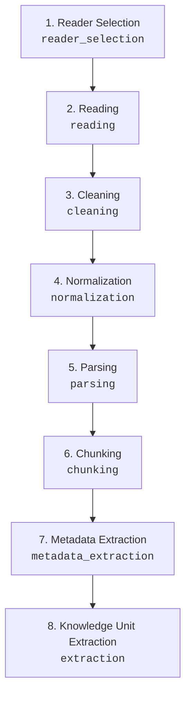

# Input & Ingestion Pipeline Architecture, Live Reporting, and Recovery Workflow

**Modules:** `src.living_authenticity.knowledge.input.processor`, `src.living_authenticity.knowledge.ingestion.pipeline`, `src.living_authenticity.knowledge.ingestion.readers`<br/>
**UI Components:** `Composer`, `ProcessingResult`, `CurrentAudit` (`frontend/src/components/Panels.tsx`)<br/>
**Adapter:** `src.living_authenticity.adapter.app`<br/>
**Status:** Authoritative Foundation

---

## 1. Overview and Responsibility

The Input stage is the single authoritative entry gate of the LivingAuthenticity Knowledge Management loop. It provides an ergonomic, zero-latency in-UI chat composer for the researcher, backed by rigorous backend validation, noise detection, privacy guards, and an interactive recovery workflow.

```text
[Composer UI] (In-place, UTF-8 byte check, draft preservation)
     │
     ▼ POST /api/run
[Adapter Layer] (Synchronous schema validation, token check)
     │
     ▼ process_input()
[Input Processor]
     ├── Source Selection ('chat_input')
     ├── Operating Mode ('personal_vault' / 'examples')
     ├── Type & Encoding (UTF-8, <= 1MB, no raw control chars)
     ├── Noise Boundaries (Punctuation-only, spam, fragment noise)
     └── Clarification Detection (Ambiguous single tokens)
     │
     ├─► ACCEPTED ────────────► Hand-off to Ingestion & Retrieval
     ├─► NEEDS_CLARIFICATION ─► Halt, Partition to failed/ audit, Surface Clarification in UI
     ├─► REJECTED ────────────► Halt, Partition to failed/ audit, Surface Error in UI
     └─► STOPPED ─────────────► Halt, Partition to failed/ audit, Surface Stopped in UI
```

---

## 2. In-UI Chat Composer

* **Positioning:** Full-width and bottom-anchored, staying firmly in place without jumping or transforming into a detached floating modal on focus.
* **Typing Experience:** In-place multiline editing with standard `Enter` (submit) and `Shift+Enter` (new line) shortcuts. Auto-grows up to 120px with smooth scrolling.
* **Exact Placeholder:**
  * English: `Type or paste here (text only — no uploads yet)`
  * Persian: `متن را اینجا بنویسید یا بچسبانید (فقط متن — بدون بارگذاری فایل)`
* **Immediate Local Feedback:** Pure client-side UTF-8 byte calculation and character count badges without latency. Submissions exceeding 1,000,000 bytes or containing only whitespace are blocked client-side.
* **Offline Draft Retention:** If the backend launcher is disconnected, the composer retains the typed text intact (no wiping) and surfaces an actionable connection banner and recovery panel.

---

## 3. Backend-Authoritative Evaluation Boundary

Client-side checks never substitute for backend authority. Every input submitted to `/api/run` is independently evaluated by `process_input()`:

### Evaluation Attributes
* **Input Identification:** Computes deterministic SHA-256 hash (`content_hash`) and assigns stable `input_id` (`inp-<hash[:12]>`).
* **Source Selection:** Rejects any interactive source other than `chat_input`.
* **Mode Verification:** Ensures source mode is strictly `personal_vault` or `examples`.
* **Structural Bounds:** Enforces UTF-8 compliance, reject null bytes / unescaped ASCII control codes, and caps size at `MAX_TEXT_BYTES = 1_000_000`.

### Structured Evaluation Outcomes (`InputOutcome`)
1. `ACCEPTED`: Valid research note text with assigned provenance. Downstream ingestion proceeds (`can_proceed=True`).
2. `REJECTED`: Structural invalidity, repeated character spam, punctuation noise, or fragment noise. Downstream processing halted; audited into `failed/`.
3. `NEEDS_CLARIFICATION`: Ambiguous single-token inputs (e.g. "a", "x", "1") requiring additional researcher context without presumption of intent.
4. `STOPPED`: Cooperative cancellation requested by researcher; stops pipeline cleanly and audits `stopped_by_user`.
5. `ERROR`: Unexpected execution error or backend unavailability.

---

## 4. Deterministic Noise Boundaries vs. Research Notes

To protect against accidental input corruption while respecting authentic research syntax:

1. **Punctuation & Symbol Noise (`_is_punctuation_or_symbol_only`):**
   * Rejects inputs containing exclusively punctuation, whitespace, or symbols without letters or numbers.
2. **Repeated Character Spam (`_is_repeated_char_spam`):**
   * Rejects sequences dominated by single repeating characters (e.g., `aaaaaaaaaa`, `سسسسسسسسسسس`, `111111111111`).
3. **Repeated Fragment Noise (`_is_repeated_fragment_noise`):**
   * Detects repeated keyboard-mashing patterns of length 2 to 8 repeating $\ge 3$ times and covering $\ge 80\%$ of text (e.g., `qwertyqwertyqwerty`, `asdfasdfasdfasdf`).
4. **Legitimate Short & Multilingual Notes Preserved:**
   * Checks leverage Unicode category testing (`unicodedata.category(ch)[0] in ('L', 'N')`).
   * Legitimate brief research queries, formulas, and multilingual expressions (e.g., `"Why?"`, `"چرا؟"`, `"AI-001"`, `"x = y + 1"`, code snippets) are classified as valid research notes and accepted.

---

## 5. In-UI Actionable Recovery Workflow

When an input is rejected, stopped, requires clarification, or fails connection:

* **Location:** Rendered prominently inside `ProcessingResult`.
* **Status Badges:** Outcome (`[REJECTED]`, `[NEEDS CLARIFICATION]`, `[STOPPED]`, `[ERROR]`), error code (`<code>`), and `run_id`.
* **Draft Display:** Renders a blockquote preview of the submitted draft (`state.lastSubmittedText`).
* **Recovery Actions:**
  * **Fix / Edit Input (`fixInput`):** Transfers the preserved draft back into the composer and focuses the textarea for immediate editing without terminal use.
  * **Retry (`retryLastInput`):** Re-submits the preserved draft to the backend.
  * **Stop / Dismiss (`dismissRunOutcome`):** Resets the run state cleanly back to idle.
* **In-Flight Cancellation:** Active runs can be stopped cooperatively at any point from `ProcessingResult` and `TopNav`, triggering backend cancellation and recording `stopped_by_user`.

---

## 6. Privacy & Audit Governance

* **Zero Raw Text Leakage:** Raw private input text is strictly excluded from persistent audit logs (`failed/audit.jsonl`).
* **Audit Metadata:** Audit entries persist only non-sensitive provenance:
  * `input_id`, `input_hash`, `outcome`, `error_code`, `byte_length`, `char_length`, `timestamp`, and `terminal_outcome` (`input_validation_failed`, `input_clarification_required`, or `stopped_by_user`).
* **Storage Isolation:** All validation failures and stopped runs are partitioned into the `failed/` storage root and never touch staging or vault storage.

---

## 7. Separation of Input Type Detection vs. Reader Selection

A strict architectural boundary separates **Input Type Detection** (Input stage) from **Reader Selection** (Ingestion stage):

```text
[Input Stage: InputProcessor]
  │  Evaluates interactive source ("chat_input"), validates payload size, UTF-8 bounds,
  │  authenticity, and noise rules. Produces InputProvenance(source="chat_input", input_id, input_hash).
  ▼
[Handoff Boundary: IngestionPipeline]
  │  Receives validated payload and InputProvenance.
  ▼
[Ingestion Stage: ReaderRegistry]
  │  Selects appropriate BaseReader implementation by format/extension ("chat_input", ".txt", ".md").
  │  Strictly fails fast (ValueError) if no reader is registered.
```

* **Input Stage Responsibility:** Focuses purely on protocol, structural boundaries, researcher intent verification, and security guarantees. It does not parse or extract note structure.
* **Ingestion Stage Responsibility:** Focuses on converting validated text/files into structured, chunked, cleaned, normalized, and parsed `KnowledgeUnit`s with full metadata and bidirectional links.

---

## 8. Ingestion Pipeline Discrete Sub-Stages

`IngestionPipeline` executes 8 discrete sub-stages in strict conceptual order, reporting granular process updates at each step:



1. **Reader Selection (`reader_selection`):**
   * Selects registered reader from `ReaderRegistry` using file extension or source format (`chat_input`).
   * Emits `status` event: `format`, `reader_name`, `run_id`.
2. **Reading (`reading`):**
   * Reads raw content without mutation (via `read_text()` or `read()`).
   * Emits `status` event: `raw_length`, `run_id`.
3. **Cleaning (`cleaning`):**
   * Unicode NFC normalization (`unicodedata.normalize("NFC", ...)`), line ending normalization (`\r\n` / `\r` -> `\n`), trailing whitespace removal per line, and blank line collapsing (3+ -> 2).
   * Emits `status` event: `cleaned_length`, `run_id`.
4. **Normalization (`normalization`):**
   * Refines cleaned representation by collapsing runs of multiple spaces within lines (`(?<=\S) {2,}` -> ` `) while strictly preserving leading indentation and line boundaries, ensuring canonical NFC precomposition.
   * Emits `status` event: `normalized_length`, `run_id`.
5. **Parsing (`parsing`):**
   * Parses frontmatter YAML, markdown headings, wiki-links (`[[...]]`), and tags (`#...`).
   * Emits `status` event: `note_type`, `relations_count`, `tags_count`, `run_id`.
6. **Chunking (`chunking`):**
   * Operates on cleaned and normalized content (`text_for_analysis`).
   * When a chunker accepts `parsed` or `**kwargs`, the parsed AST is passed (`chunker.split(text_for_analysis, parsed=parsed)`).
   * Legacy or third-party chunkers with `split(text)` receive only `text_for_analysis`.
   * When parsing is optional or yields no parsed structure (e.g. plain text), chunking proceeds normally on `text_for_analysis`.
   * Emits `status` event: `chunk_count`, `chunker`, `run_id`.
7. **Metadata Extraction (`metadata_extraction`):**
   * Extracts structured source and input metadata (`source`, `file_name`, `extension`, `reader`, `chunk_count`, `input_id`, `input_hash`).
   * Emits `status` event: `source`, `reader`, `run_id`.
8. **Knowledge Unit Extraction & Provenance Recording (`extraction`):**
   * Constructs structured, non-authoritative analytical `KnowledgeUnit` instances (analytical representation only; never authoritative knowledge or state mutation).
   * Preserves `input_id` and `input_hash` provenance directly on each unit and within `IngestionResult.metadata` without conflating input-level hashes with unit-level content hashes.
   * Emits `status` event: `unit_count`, `unit_ids`, `run_id`.

---

## 9. Multi-Format Readiness & Fail-Fast Registry Contract

The ingestion subsystem is architecturally structured around registry patterns:
* `ReaderRegistry`: Maps extensions (`.txt`, `.md`) and source identifiers (`chat_input`, `text`) to `BaseReader` implementations.
* `ChunkerRegistry`: Maps format identifiers to chunkers (`TextChunker`, `MarkdownChunker`).
* `ExtractorRegistry`: Maps format identifiers to parser/extractors (`TextExtractor`, `MarkdownExtractor`).

### Fail-Fast Contract
* **Currently Supported:** In-memory interactive text (`chat_input`), plain text files (`.txt`), and markdown notes (`.md`).
* **Intentionally Unsupported:** Binary file types (PDF, Word `.docx`, audio, images, spreadsheets) are not yet implemented.
* **No Premature Stubs:** If an unregistered format or file extension (e.g. `document.pdf`) is presented, `ReaderRegistry.get()` immediately raises `ValueError("No reader registered for ...")`. The pipeline never simulates unsupported formats or pretends they succeeded.

---

## 10. Granular Process Reporting & Live Observation (SSE)

Real-time pipeline transparency is provided through Server-Sent Events (SSE) streaming over the launcher transport:

### Event Schema (`status` event)
```json
{
  "kind": "status",
  "stage": "ingestion",
  "substage": "cleaning",
  "message": "Cleaned raw input text (240 chars)",
  "cleaned_length": 240,
  "run_id": "run-001"
}
```

* **Truthful Data Only:** All event payloads reflect actual measured values (e.g., character counts, chunk counts, unit IDs). No simulated or fabricated LLM monologues.
* **Selective Observation:** Corpus background ingestion (`_load_knowledge_corpus`) remains quiet (`stage_observer=None`), preventing background library indexing from flooding the active run's event stream.
* **Frontend Localization:** Sub-stage keys (`ui.ingestion.cleaning`, `ui.ingestion.extraction`, etc.) are localized symmetrically in English and Persian in `frontend/src/i18n/resources.ts`.

---

## 11. End-to-End Provenance Continuity & Audit Integration

Every knowledge unit processed through the pipeline carries complete provenance through its entire lifecycle:

```text
[Input Stage]
  InputProvenance(input_id="inp-abc...", input_hash="hash...", source_type="chat_input", run_id="run-001")
      │
      ▼
[Ingestion Stage]
  KnowledgeUnit(
    id="ku-xyz...",
    source="chat_input:inp-abc...",
    original_text="...",
    meaning="...",
    cleaned_text="...",
    normalized_text="..."
  )
  IngestionResult.metadata = {
    "source": "chat_input:inp-abc...",
    "reader": "ChatInputReader",
    "chunk_count": 2,
    "input_id": "inp-abc...",
    "input_hash": "hash..."
  }
      │
      ▼
[Downstream Pipeline (Classification, Retrieval, Proposal Generation)]
  Proposal(
    query_unit_id="ku-xyz...",
    query_source="chat_input:inp-abc...",
    query_position=0,
    action="CREATE",
    title="...",
    destination="staging/...",
    provenance=("query:ku-xyz...@chat_input:inp-abc...#0", ...)
  )
      │
      ▼
[Audit Persistence]
  AuditRecord(
    run_id="run-001",
    query_source="chat_input:inp-abc...",
    query_unit_id="ku-xyz...",
    input_hash="hash...",
    provenance=["query:ku-xyz...@chat_input:inp-abc...#0", ...]
  )
```

* **Storage Partitions:**
  * `passed/audit.jsonl`: Approved and executed `CREATE` proposals that successfully generated a staging artifact (`execution_executed=True`).
  * `errors/audit.jsonl`: Managed operational halts (e.g., mandatory LLM gate safe stop, audit persistence failures before execution, cooperative cancellations).
  * `failed/audit.jsonl`: Input validation rejections, clarifying questions, researcher rejections, non-`CREATE` held proposals (`NEEDS_REVIEW`, `DO_NOT_IMPORT`), and execution rejections.

---

## 12. Cryptographic Hash Distinctions & Provenance Contracts

The governance architecture avoids mixing type markers into cryptographic digests and clearly separates different hash types into dedicated fields:

| Hash Field | Schema / Location | Calculation Basis | Purpose |
|:---|:---|:---|:---|
| `input_hash` | `AuditRecord`, `KnowledgeUnit`, `InputProvenance` | SHA-256 over raw input text bytes (pure 64-hex chars) | Verifies complete source input integrity |
| `input_hash_source` | `AuditRecord`, `_trace_for_audit` | `"input_provenance"` or `"unit_content_fallback"` | Disambiguates full input hash from unit content fallback |
| `proposal_hash` | `AuditRecord`, `ApprovalRequest`, `Proposal` | Canonical SHA-256 over canonical JSON payload (`proposal_payload()`) | Binds human approval strictly to immutable proposal & note |
| `evidence_hash` | `AuditRecord`, `_trace_for_audit` | SHA-256 over pipe-separated evidence unit IDs (`ku-...`) | Records exact evidence units cited in the proposal |
| `artifact_sha256` | `AuditRecord`, `IntegrationUnitEntry` | SHA-256 over staged note markdown text bytes | Cryptographically verifies written staging file integrity |

---

## 13. Editable Proposal Hash Lifecycle & Human Approval Loop

The proposal approval loop allows the human researcher to supervise and edit `CREATE` proposals while strictly maintaining cryptographic integrity:

```mermaid
sequenceDiagram
    participant UI as Human Researcher / UI
    participant Gate as PublishingGate
    participant Launcher as Launcher
    participant Loop as _govern_candidate
    participant Val as Revalidator
    participant Exec as ControlledExecutor
    participant Audit as AuditWriter

    Loop->>Gate: request_approval(query, proposal_H0, note_H0)
    Gate->>Launcher: register_approval(request_H0)
    UI->>Launcher: edit_proposal(title, body, reason)
    Note over Launcher: apply_proposal_edit() generates proposal_H1<br/>provenance += 'supersedes:H0'<br/>computes canonical hash H1
    Launcher-->>Gate: consume_pending_edit(H0) -> (proposal_H1, note_H1)
    Note over Gate: Stale approval of H0 invalidated.<br/>Rebuilds request_H1; loops.
    Gate->>Launcher: register_approval(request_H1)
    UI->>Gate: approve(request_H1) -> outcome_H1
    Gate-->>Loop: return request_H1, outcome_H1, proposal_H1, note_H1
    Loop->>Val: revalidate(request_H1, outcome_H1, proposal_H1, note_H1)
    Val-->>Loop: valid=True
    Loop->>Exec: execute(request_H1, outcome_H1, proposal_H1, note_H1)
    Exec->>Exec: Write <H1>.md to staging
    Exec-->>Loop: ExecutionResult(artifact_path='<H1>.md')
    Loop->>Audit: record_audit_for_execution(...)
    Note over Audit: Links H1, artifact_sha256, and 'supersedes:H0' to audit.jsonl
```

* **Authoritative Recomputation:** Edits are recomputed server-side in `apply_proposal_edit()`; client-supplied hashes are strictly ignored.
* **Stale Approval Invalidation:** Because approval is bound to `proposal_hash`, any edit produces $H_1 \ne H_0$, invalidating prior approvals.
* **Fail-Closed Tamper Protection:** If note or proposal contents are altered without re-approval, `Revalidator.revalidate()` fails closed (`proposal_contents` or `proposal_identity` check failure), preventing controlled execution.
